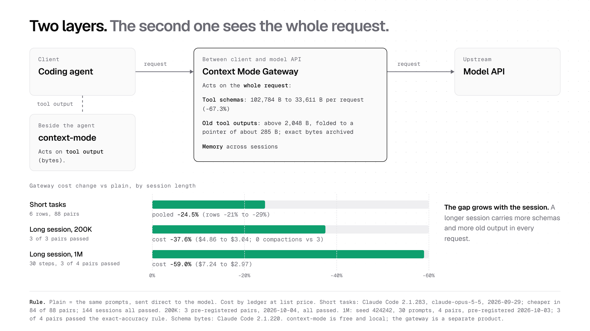

# Context Mode

**Keeping tool output out of a coding agent's context window: a local plugin for 10 agents, and the Gateway that works on the whole request.**

[](https://www.npmjs.com/package/context-mode) [](https://www.npmjs.com/package/context-mode) [](https://github.com/mksglu/context-mode) [](https://github.com/mksglu/context-mode) [](https://news.ycombinator.com/item?id=47193064) [](https://github.com/uibm/trending-watcher/issues?q=%22mksglu%2Fcontext-mode%22) [](https://discord.gg/DCN9jUgN5v) [](LICENSE)

> **Context Mode Gateway** is the paid layer. It runs between your agent and the model API and adds Recall for long sessions, Memory, Skills, Search, Protect and request-level saving.
> Free: 1,000 requests a month, every feature, no card. Start at [contextmode.ai](https://contextmode.ai). Plans: [https://contextmode.ai/pricing](https://contextmode.ai/pricing).

<picture>
  <source media="(prefers-color-scheme: dark)" srcset="docs/assets/readme/hero-dark.png">
  
</picture>

**Figure 1.** Context Mode at a glance. Counts as of 2026-11-01 (33,053 stars, read once from the GitHub API). The 98.8% is the median over the 25 bench rows with 10 KB or more of raw output, 5 runs each.

<p align="center">
<sub>Starred by engineers at</sub>
<br><br>
<a href="#"></a>
<a href="#"></a>
<a href="#"></a>
<a href="#"></a>
<a href="#"></a>
<a href="#"></a>
<a href="#"></a>
<a href="#"></a>
<a href="#"></a>
<a href="#"></a>
<a href="#"></a>
<a href="#"></a>
<a href="#"></a>
<a href="#"></a>
<a href="#"></a>
<a href="#"></a>
<a href="#"></a>
<a href="#"></a>
</p>

## Abstract

A coding agent reads files, runs commands and fetches pages, and every result goes into its context window.
One Playwright snapshot is 57.5 KB; one access log is 46.2 KB. The window fills, the agent compacts, and it forgets what it was doing.
Context Mode runs the tool work in a local sandbox, keeps the full output in a per-project SQLite index, and returns only what the agent asks for.
On the 25 bench rows with 10 KB or more of raw output, it cut the bytes that reach the context by a median of 98.8%, measured with `ctx_bytes` against `raw_bytes`, 5 runs each.
Context Mode Gateway works on the whole request and the whole account. On a pre-registered long session with a 200K window it cut cost from $4.86 to $3.04 (2026-10-04) (-37.6%), and the session never compacted.
You can use both layers together. This paper gives the method, the numbers with their raw files, and the limits.

## 1. The problem

Each tool result goes into the context window whole. Table 1 lists real outputs from the bench, and what Context Mode returns for each.

**Table 1.** Raw output against the reply the agent sees (median of 5 runs, bench of 2026-10-31).

| Tool output | Raw | Reply | Cut |
|---|---:|---:|---:|
| Playwright page snapshot | 57,521 B | 315 B | 99.5% |
| 20 GitHub issues | 60,310 B | 1,156 B | 98.1% |
| Access log, 500 requests | 46,216 B | 171 B | 99.6% |
| `npm install` log | 37,761 B | 451 B | 98.8% |
| Big source file | 61,576 B | 489 B | 99.2% |
| Large git log | 191,120 B | 153 B | 99.9% |
| Docs page through WebFetch | 215,354 B | 435 B | 99.8% |

Rule for every headline number in this paper: rows with 10 KB or more of raw output, median per category.
The full results file has [every row, including small outputs where there is little to save](bench/results/2026-10-31-darwin-arm64.md).

## 2. Results

<picture>
  <source media="(prefers-color-scheme: dark)" srcset="docs/assets/readme/fig-saving-dark.png">
  
</picture>

**Figure 2.** Median bytes saved per category, rows of 10 KB or more.

**Table 2.** Bytes kept out of context, by category (rule: raw output of 10 KB or more, median per category).

| Category | What runs | Rows | Median cut |
|---|---|---:|---:|
| a. Sandbox | `ctx_execute` on a file or command | 10 | 99.3% |
| c. Batch | `ctx_batch`: many commands, then search | 2 | 93.1% |
| d. Externalize | Host tool output over the cap, indexed whole | 4 | 92.3% |
| f. Hook redirect | A big Read, curl or WebFetch sent to the sandbox | 5 | 99.8% |
| g. Session total | One full scripted session | 1 | 98.8% |

Search replies (category b) return text on purpose; they are in the full file. Bench on 2.0.0-next.8, macOS arm64, 2026-10-31.
Reproduce: `cd bench && node run.mjs`. Method and every data file: [bench/README.md](bench/README.md), [bench/evidence/](bench/evidence/README.md).
We measured bytes, not dollars, so the plugin makes no cost claim.

### 2.1 Case studies

**Case 1. A browser snapshot.** Problem: one Playwright snapshot is 57,521 B, and an agent takes many per task.
Action: the agent runs the snapshot through `ctx_execute` and prints only the fields it needs.
Result: 315 B reach the context, a 99.5% cut, measured over 5 runs.

**Case 2. A docs page.** Problem: a WebFetch of the SQLite FTS5 page returns 215,354 B.
Action: the `PreToolUse` hook denies the fetch and routes it to `ctx_index`, which keeps the page, and `ctx_search`, which returns the part asked for.
Result: a 435 B reply instead of 215,354 B, a 99.8% cut. The hook took 54 ms.

**Case 3. A long session (Gateway).** Problem: a long Claude Code session on a 200K window compacts, and the agent loses its place.
Action: the same task through Context Mode Gateway with Recall, 3 pairs, with a rule fixed before the run.
Result: cost fell from $4.86 to $3.04 (2026-10-04) (-37.6%). Direct compacted 3 times; the Gateway session never compacted. 3 of 3 pairs passed.

### 2.2 Two layers: the gap grows with session length

<picture>
  <source media="(prefers-color-scheme: dark)" srcset="docs/assets/readme/fig-layers-dark.png">
  
</picture>

**Figure 3.** context-mode works beside the agent, on tool output, in a local sandbox. Context Mode Gateway runs between the client and the model API and works on the whole request and the whole account. You can use both together.

**Table 3.** Gateway cost against Claude Code alone, Claude Opus 5.5. Mean dollars per session at list price.

| Session | Direct | Gateway | Change | Rule check | Raw file |
|---|---:|---:|---:|---|---|
| Six short tasks (2026-09-29) | | | -21% to -29% per task, -24.5% pooled | cheaper in 84 of 88 pairs; all 176 sessions passed the task check | [v3-opus55-short.json](https://contextmode.ai/benchmarks/data/v3-opus55-short.json) |
| Long session, 200K window (2026-10-03/04) | $4.86 | $3.04 | -37.6% | 3 of 3 pre-registered pairs passed; 0 compactions against 3 | [ab.json](https://contextmode.ai/benchmarks/recall/200k-r2/ab.json) |
| Long session, 1M window, 30 steps (2026-10-03) | $7.24 | $2.97 | -59.0% | 3 of 4 pairs passed the exact-accuracy rule | [ab.json](https://contextmode.ai/benchmarks/long-session/amendment-4/ab.json) |

The longer the session, the more the Gateway saves: a short task has little history to fold.
On the five counted "try it" prompts (2026-10-22, Claude Opus 5.5) the Gateway cost 43.8% less, but it passed the task check in 15 of 20 sessions against 20 of 20 direct.
We fixed the rules before each run: [contextmode.ai/docs/benchmarks](https://contextmode.ai/docs/benchmarks).

## Install

Use your agent's own install command. You need Node 24.15.0 or later (v2 uses the built-in `node:sqlite`). On Windows you also need Git for Windows: the shell tools run in Git Bash, and `context-mode doctor` check D11 (shell) fails without it.

| Agent | Install | Update |
|---|---|---|
| Claude Code | `claude plugin marketplace add mksglu/context-mode#release`, then `claude plugin install context-mode@context-mode` | `claude plugin update context-mode@context-mode` |
| Codex | `codex plugin marketplace add mksglu/context-mode@release`, then `codex plugin add context-mode@context-mode` | `codex plugin marketplace upgrade context-mode` |
| Gemini CLI | `gemini extensions install https://github.com/mksglu/context-mode --ref release` | `gemini extensions update context-mode` |
| Qwen Code | `qwen extensions install https://github.com/mksglu/context-mode:context-mode --ref release` | `qwen extensions update context-mode` |
| Pi | `pi install npm:context-mode@next` | `pi update --extensions` |
| OpenCode | `opencode plugin add context-mode@next` (1.19: `opencode plugin context-mode@next --global`) | `opencode plugin update` (1.19: `opencode plugin context-mode@next --global --force`) |

Until v2 is on `main`, `main` holds the old build (1.0.169), so the four GitHub-source rows name the `release` branch with each agent's own syntax.

After v2 is on main: `claude plugin marketplace add mksglu/context-mode`, `codex plugin marketplace add mksglu/context-mode`, `gemini extensions install https://github.com/mksglu/context-mode`, `qwen extensions install https://github.com/mksglu/context-mode:context-mode`

Already installed from GitHub without the ref? Each agent page has the steps to switch: see "Already installed from GitHub?" in [Claude Code](docs/install/claude-code.md#already-installed-from-github), [Codex](docs/install/codex.md#already-installed-from-github), [Gemini CLI](docs/install/gemini.md#already-installed-from-github) and [Qwen Code](docs/install/qwen.md#already-installed-from-github).

Copilot CLI, Kiro, VS Code and ZCode have no install command of their own for this package. Use npm, which also works for every other agent:

```sh
npm i -g context-mode@next
context-mode setup
```

`next` is the v2 prerelease tag on npm. `latest` stays on the old release. A plain `npm i -g context-mode` does not install v2.
Restart the agent, then check: `context-mode doctor` (or `/ctx-doctor` in the agent). Each check prints PASS, or FAIL with the command that fixes it.
`context-mode setup` is the fallback and the repair. It shows a plan, applies it, and rolls back an agent that fails.
Uninstall: `context-mode setup --remove && npm rm -g context-mode`. Details: [docs/install/README.md](docs/install/README.md).

Every agent gets hooks, the MCP server and the skills. The Install column is the agent's own install command, or the npm route when the agent has none.

<!-- agents:install:start (node build/readme-agents.mjs --write) -->
| Agent | Hooks | MCP | Skills | Install | Guide |
|---|---|---|---|---|---|
| Claude Code | yes, package | yes | yes | `claude plugin install context-mode@context-mode` | [docs/install/claude-code.md](docs/install/claude-code.md#install) |
| Codex | yes, hook file | yes | yes | `codex plugin add context-mode@context-mode` | [docs/install/codex.md](docs/install/codex.md#install) |
| Copilot CLI | yes, hook file | yes | yes | npm + `context-mode setup` | [docs/install/copilot-cli.md](docs/install/copilot-cli.md#install) |
| Gemini CLI | yes, package | yes | yes | `gemini extensions install https://github.com/mksglu/context-mode --ref release` | [docs/install/gemini.md](docs/install/gemini.md#install) |
| Kiro | yes, hook file | yes | yes | npm + `context-mode setup` | [docs/install/kiro.md](docs/install/kiro.md#install) |
| OpenCode | yes, in-process | yes | yes | `opencode plugin add context-mode@next` | [docs/install/opencode.md](docs/install/opencode.md#install) |
| Pi | yes, in-process | in-process | yes | `pi install npm:context-mode@next` | [docs/install/pi.md](docs/install/pi.md#install) |
| Qwen Code | yes, package | yes | yes | `qwen extensions install https://github.com/mksglu/context-mode:context-mode --ref release` | [docs/install/qwen.md](docs/install/qwen.md#install) |
| VS Code (Copilot) | yes, hook file | yes | yes | npm + `context-mode setup` | [docs/install/vscode.md](docs/install/vscode.md#install) |
| ZCode | yes, hook file | yes | yes | npm + `context-mode setup` | [docs/install/zcode.md](docs/install/zcode.md#install) |
<!-- agents:install:end -->

## 3. How it works

<picture>
  <source media="(prefers-color-scheme: dark)" srcset="docs/assets/readme/fig-flow-dark.png">
  
</picture>

**Figure 4.** One tool call, step by step. Output stays in the sandbox and the index; the agent gets the answer.

Context Mode has three parts: hooks, an MCP server with nine tools, and one SQLite database per project.

### 3.1 Hooks

The hooks listen to four events: `SessionStart`, `UserPromptSubmit`, `PreToolUse`, `PostToolUse`. Gemini CLI, VS Code and OpenCode also send a compaction event; each host keeps its own event names.
`PreToolUse` checks rules in a fixed order: the user's deny list, WebFetch, curl and HTTP or build commands, then Read and shell dumps.
Context Mode denies a `Read` of a file over 16,384 B with no range, and the deny message names the exact `ctx_execute` call to use. A `Read` with a range still runs.
A hook never errors. Every failure ends in exit 0 with the host's "allow" reply and one log line, so a bug in Context Mode never blocks your agent. Spawned hooks time out after 5,000 ms.

### 3.2 Sandbox execution

`ctx_execute` writes the script to a temp folder and runs it as a subprocess: shell, PowerShell, JavaScript, TypeScript, Python, or any runtime found on `PATH`.
It starts the process with an argument list and no shell, in the project folder. The default and maximum timeout is 600,000 ms; on timeout it kills the whole process group (`taskkill /F /T` on Windows).
The child gets the parent environment minus the preload variables (`NODE_OPTIONS`, `BUN_OPTIONS`, `DENO_OPTIONS` and similar). Only what the script prints comes back, cut on a whole character.

### 3.3 Index and search

Each output goes into SQLite FTS5 twice: a Porter-stemmed table for words, and a trigram table for paths, names and parts of words.
`ctx_search` ranks each table with BM25 and joins the two lists with Reciprocal Rank Fusion: a hit scores 1/(60 + rank) in each list.
When nothing matches, it tries a spelling fix from the indexed words. Search covers one of three scopes: this session, this worktree (the default) or the whole project.
Chunks are at most 4,096 B. A Markdown chunk never crosses a heading and carries its heading path as its title. A code block that fits in a chunk is never split; a bigger one splits on blank lines, and each piece repeats the fence.
A reply snippet is at most 800 B, or a whole code block up to 2,048 B.

### 3.4 Large output, run and replace

When a host tool returns more than the cap, `PostToolUse` indexes the whole output and replaces it.
The agent gets the best-matching whole chunks and one `ctx_search` line for the rest. Context Mode keeps the full text in the index.

### 3.5 Session continuity

The hooks log each prompt, edit, command, tool error, index, cost and decision.
After a compaction the agent gets a state block of at most 2,048 B built from that log. Context Mode cuts no line: a long line becomes a `ctx_resume(seq)` pointer that reads the full row.
On the next prompt, a recall block of at most 2,048 B brings back the log rows that match it by BM25, whole rows only. The same rows always give the same bytes.

### 3.6 Storage

Context Mode uses Node's built-in `node:sqlite`; no native module to build. Each project gets one `context.db` under `~/.context-mode`.
The database runs in WAL mode. On close it runs a PASSIVE checkpoint and never TRUNCATE. Context Mode builds a new database under a temp name, then moves it into place in one step, so a crash leaves no half-made file. Busy timeout: 5,000 ms.

## 4. Tools

| Tool | What it does |
|---|---|
| `ctx_execute` | Runs code or a shell command in a sandbox; returns only what it prints |
| `ctx_batch` | Runs many commands, indexes the output, and searches it in one call |
| `ctx_index` | Indexes a file, a text or a URL into the project database |
| `ctx_search` | Searches the index; returns the matching parts only |
| `ctx_resume` | Returns the state block, or one full row by `seq` |
| `ctx_stats` | Shows how much output stayed out of context |
| `ctx_doctor` | Checks the install; each FAIL line names its fix |
| `ctx_upgrade` | Installs, upgrades or uninstalls; replaces old context-mode entries |
| `ctx_purge` | Deletes indexed data by session, source or project |

Full reference: [docs/tools.md](docs/tools.md).

## Commands

| Command | What it does |
|---|---|
| `/ctx-stats` | Calls `ctx_stats` and shows the result |
| `/ctx-doctor` | Calls `ctx_doctor`; use its report when you report a defect |
| `/ctx-upgrade` | Calls `ctx_upgrade`, then `ctx_doctor` |

## 5. Harness: ten agents

Every agent in the Install table gets hooks, the MCP server and the skills, through that agent's own install command.
Hooks reach each agent in one of three ways: in the plugin package (Claude Code, Gemini CLI, Qwen Code), in a hook file (Codex, Copilot CLI, Kiro, VS Code, ZCode), or in-process (OpenCode, Pi).

Live proof, written for 2.0.0-next.15: we watched the real agent binary run our hook in a temp home, with no login and no API key, for 8 of 10 agents.
Not yet proven live: VS Code (the hook command works with the documented payload, but VS Code 1.144.0 sent no request) and Kiro (kiro-cli 2.35.2 loads all 6 entries, but we saw no hook fire).
CI runs setup, doctor, a hook and an MCP handshake for all 10 agents from the packed package on Linux, macOS and Windows. Record: [docs/architecture/release/HOOKS-FIRE.md](docs/architecture/release/HOOKS-FIRE.md).

## 6. Performance

**Table 4.** Time cost, median of 5 runs, bench of 2026-10-31.

| Measure | Result |
|---|---|
| Hook time over a bare `node` start, per agent | 7.3 ms to 14.6 ms |
| `ctx_search`, 20 queries over 8 indexed files | 1.73 ms median, 6.54 ms max |
| `ctx_index`, 3 real files, 0.6 MB | 155 ms per MB |

Rows per agent and per query: [docs/performance.md](docs/performance.md).

## 7. Security model

- No telemetry. Context Mode sends no data about you or your code anywhere.
- No LLM calls. Context Mode never calls a model.
- All data stays in the `context.db` file of each project, on your machine.
- Network use: npm or git (to the release repository) when you install or upgrade, `git ls-remote` in doctor (to check for a new version), and your agent's own install steps.
- `ctx_index` fetches a URL only when the agent asks for it. It blocks private and link-local addresses. It checks each address the host name points to, connects to the address it checked, and checks again at each redirect.
- Doctor and the debug report remove secrets by their structure before they print.

What the sandbox does not do: it does not isolate. There is no container, chroot, seccomp or namespace.
Code from `ctx_execute` runs as you, with your environment (minus the preload variables), your whole file system and your network.
Here "sandbox" means the output stays out of the context, not that the code is isolated. Keep your agent's own permission prompts on.

## 8. Context Mode Gateway

Context Mode Gateway is the paid product. The plugin works beside the agent, on tool output. The Gateway runs between your agent and the model API and works on every request and the whole account.
It adds what a local plugin cannot: Recall for sessions longer than the window, Memory shared by all your agents, Skills, Search over everything that passed through, and Protect.

**Table 5.** Context Mode Gateway features, from [contextmode.ai/docs](https://contextmode.ai/docs/how-saving-works).

| Feature | What it does | Measured result | Main limit |
|---|---|---|---|
| Context Saving | Folds old tool output, runs data work as code (Thinking in Code), trims tool schemas, places cache marks | Tool schemas 102,784 B to 33,611 B per request (-67.3%); a tool output over 2,048 B becomes a pointer of about 285 B, with the full copy archived | A short question with few tool calls leaves little to save; no Codex A/B yet |
| Recall | The model sees recent work and an index of older work; the agent searches the archive for the rest | 200K window, 2026-10-04: $4.86 to $3.04 (-37.6%), 3 of 3 pre-registered pairs passed, 0 compactions against 3 | Cost measured in Claude Code on Claude Opus 5.5, not yet in Codex |
| Memory | Each fact keeps two times: when it was true and when the Gateway learned it | Not a cost feature; Claude Code and Codex on one account share one store, tested end to end | Small evals so far; the memory block adds input tokens to a new session's first request |
| Skills | A skill catalog on the Gateway for your account; it loads the skill that matches your message | Not a cost feature | Imports come from GitHub; a loaded skill adds its whole body to the prompt |
| Search | Searches the prompts, commands and tool output that passed through, in the console and as an agent tool | Not a cost feature | The console searches the first 4,000 characters of each tool result |
| Session resume | One command rebuilds a conversation as a native Claude Code or Codex session | Not a cost feature | Brings back text, tool names and a summary, not every tool output; the command expires after 15 minutes |
| Active Context | Sets how much a thread carries before its oldest parts move to the archive: 200K, 500K or 1M tokens | Not a cost feature | An image older than the kept part becomes a short note and cannot be read back |
| Instructions | One text of at most 4,096 characters that tells every agent how to answer you | Read from the provider cache after the first request | Changes how the agent writes, not what it does |
| Protect | A tool-call firewall: checks shell commands, file reads and writes, web fetches and tool-server calls by what they do | No block-rate study yet | Reads the call, not the program: a script file or a path built at run time is not checked; off until you turn it on |
| Prompt caching | Keeps requests cache-friendly: cache marks on the fixed part of the prompt and a cache for fetched pages | Inside the measured costs above | The provider accepts at most 4 cache marks |
| Live and Analytics | Shows each request and what the Gateway saved, as it happens and over time | Not a cost feature | Sees only requests that pass through the Gateway |

Apps: Claude Code, Claude Desktop, Codex, Codex Desktop, T3 Code, OpenCode and Pi.
Setup is one command, `npx @context-mode/cli`. It signs you in and writes one config change per agent (it needs Node 20.12 or later).
Your own Claude or OpenAI account pays the model, and we add no fee on tokens.
Every plan has every feature. Free: 1,000 requests a month, no card; the count starts again on the first day of each month (UTC).
Plans and prices: [https://contextmode.ai/pricing](https://contextmode.ai/pricing). Enterprise can run in your own Cloudflare account, where you hold the data, the keys and the logs.

Limits today: the Gateway does not run your code in an OS sandbox, has no SSO or team roles yet, and routes to Anthropic and OpenAI only.
Requests pass through the Gateway server, so it is not local only. Protect reads the call, not the program, so keep your agent's sandbox on.

**Start free at [contextmode.ai](https://contextmode.ai).**

## 9. Adoption

<picture>
  <source media="(prefers-color-scheme: dark)" srcset="docs/assets/readme/star-history-dark.png">
  
</picture>

**Figure 5.** GitHub stars over time, from the stargazers API; the last point is the live count, 33,053, read on 2026-11-01.

- **Users.** 747.4k+ users: 683.2k+ from npm and 64.1k+ from the plugin marketplace ([stats.json](stats.json), 2026-11-01).
- **Hacker News.** "MCP server that reduces Claude Code context consumption by 98%" reached the front page with 570+ points and 107 comments on 2026-02-28 ([thread](https://news.ycombinator.com/item?id=47193064)).
- **GitHub Trending.** A bot that watches GitHub Trending logged the repo there on 14 days from 2026-04-24 to 2026-10-17 ([uibm/trending-watcher](https://github.com/uibm/trending-watcher/issues?q=%22mksglu%2Fcontext-mode%22)).
- **Companies.** Engineers at the companies under Figure 1 starred the repo.

## Limitations

- The bench measures bytes, not dollars or task success. A token count here is bytes / 4, an estimate.
- Small outputs gain little. Search replies (category b) return text on purpose, so their cut is lower than the headline; the full file has it.
- The bench ran on one machine (macOS arm64) on 2.0.0-next.8; the live hook proof is for 2.0.0-next.15.
- VS Code and Kiro hooks are not yet proven live. Two Windows shell defects are open (Qwen Code, Kiro).
- The sandbox does not isolate code from your system (section 7).
- Gateway costs come from Claude Code on Claude Opus 5.5. On the 1M-window run, only 3 of 4 pairs passed the exact-accuracy rule. No Codex A/B yet.
- Known gaps: [OPEN-ITEMS.md](https://github.com/mksglu/context-mode/blob/274600e2ffab843e89c1dfa09b0d649e650c962f/docs/v2/OPEN-ITEMS.md).

## License

[Elastic License 2.0](LICENSE) (ELv2), source-available. You may use, copy, change and share the code, and use it at work.
You may not do two things:

1. Offer it to others as a hosted or managed service.
2. Remove, hide or get around its license notices or license key functions.

We chose ELv2 so the source stays open to all, but no one can sell it back as a closed hosted service.

## Cite

If you use Context Mode in research, cite it as below. GitHub also reads [CITATION.cff](CITATION.cff).

```bibtex
@software{koseoglu_context_mode_2026,
  author  = {Koseoglu, Mert},
  title   = {Context Mode: Keeping Tool Output Out of a Coding Agent's Context Window},
  year    = {2026},
  version = {2.0.0-next.21},
  url     = {https://github.com/mksglu/context-mode},
  license = {Elastic-2.0}
}
```

## Support

Report a defect on [Discord](https://discord.gg/DCN9jUgN5v) with the full `/ctx-doctor` report.
Only v2 gets fixes. This repo does not take pull requests.

Docs: [docs/install/README.md](docs/install/README.md) (install, options, uninstall), [docs/how-it-works.md](docs/how-it-works.md), [docs/algorithms.md](docs/algorithms.md) (search, ranking, size limits, deny rules), [docs/tools.md](docs/tools.md), [bench/evidence/](bench/evidence/README.md).
