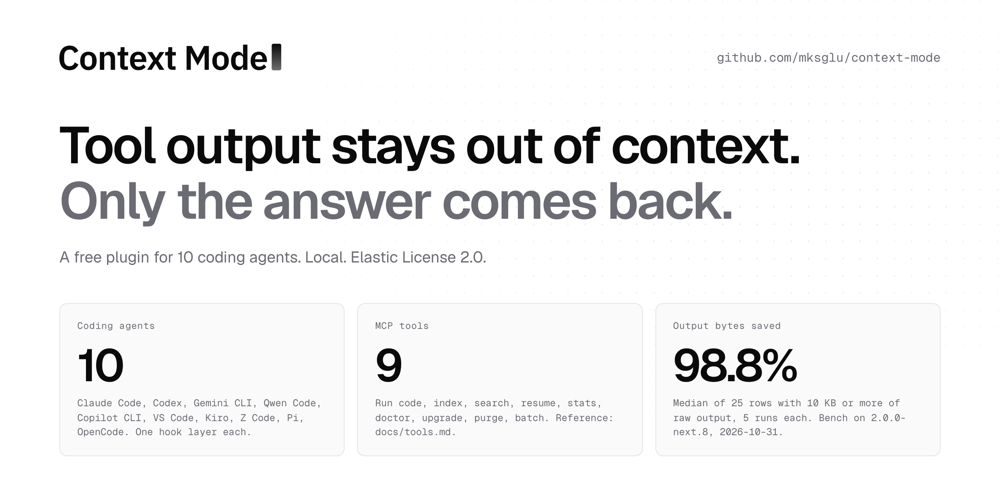

# Context Mode

**Keeping tool output out of a coding agent's context window: a local plugin for 10 agents, and the Gateway that works on the whole request.**

[](https://www.npmjs.com/package/context-mode) [](https://github.com/mksglu/context-mode) [](https://news.ycombinator.com/item?id=47193064) [](https://github.com/uibm/trending-watcher/issues?q=%22mksglu%2Fcontext-mode%22) [](https://discord.gg/DCN9jUgN5v) [](LICENSE)

> **Context Mode Gateway** takes the same idea from tool output to the whole conversation. It is an optional hosted service that works next to this plugin: Recall keeps long sessions searchable, and Memory shares what your agents learn across sessions and tools. The plugin stays free, local and open source. [See how the Gateway works](https://contextmode.ai/docs/how-saving-works)

<picture>
  <source media="(prefers-color-scheme: dark)" srcset="docs/assets/readme/hero-dark.png">
  
</picture>

**Figure 1.** Context Mode at a glance. The 98.8% is the median over the 25 bench rows with 10 KB or more of raw output, 5 runs each.

<p align="center">
<sub>Starred by engineers at</sub>
<br><br>
<a href="#"></a>
<a href="#"></a>
<a href="#"></a>
<a href="#"></a>
<a href="#"></a>
<a href="#"></a>
<a href="#"></a>
<a href="#"></a>
<a href="#"></a>
<a href="#"></a>
<a href="#"></a>
<a href="#"></a>
<a href="#"></a>
<a href="#"></a>
<a href="#"></a>
<a href="#"></a>
<a href="#"></a>
<a href="#"></a>
</p>

## Abstract

A coding agent reads files, runs commands and fetches pages, and every result goes into its context window.
One Playwright snapshot is 57.5 KB; one access log is 46.2 KB. The window fills, the agent compacts, and it forgets what it was doing.
Context Mode runs the tool work in a local sandbox, keeps the full output in a per-project SQLite index, and returns what the agent asks for.
On the 25 bench rows with 10 KB or more of raw output, it cut the bytes that reach the context by a median of 98.8%, measured with `ctx_bytes` against `raw_bytes`, 5 runs each.
Context Mode Gateway, an optional hosted service, takes the same idea to the whole conversation and all your agents. On a pre-registered long session with a 200K window it cut cost from $4.86 to $3.04 (2026-10-04) (-37.6%).
You can use both layers together. This paper gives the method, the numbers with their raw files, and the test setup behind each one.

## 1. The problem

Each tool result goes into the context window whole. Table 1 lists real outputs from the bench, and what Context Mode returns for each.

**Table 1.** Raw output against the reply the agent sees (median of 5 runs, bench of 2026-10-31).

| Tool output | Raw | Reply | Cut |
|---|---:|---:|---:|
| Playwright page snapshot | 57,521 B | 315 B | 99.5% |
| 20 GitHub issues | 60,310 B | 1,156 B | 98.1% |
| Access log, 500 requests | 46,216 B | 171 B | 99.6% |
| `npm install` log | 37,761 B | 451 B | 98.8% |
| Big source file | 61,576 B | 489 B | 99.2% |
| Large git log | 191,120 B | 153 B | 99.9% |
| Docs page through WebFetch | 215,354 B | 435 B | 99.8% |

Rule for every headline number in this paper: rows with 10 KB or more of raw output, median per category.
The full results file has [every row, including small outputs, where the cut is smaller](bench/results/2026-10-31-darwin-arm64.md).

## 2. Results

<picture>
  <source media="(prefers-color-scheme: dark)" srcset="docs/assets/readme/fig-saving-dark.png">
  
</picture>

**Figure 2.** Median bytes saved per category, rows of 10 KB or more.

**Table 2.** Bytes kept out of context, by category (rule: raw output of 10 KB or more, median per category).

| Category | What runs | Rows | Median cut |
|---|---|---:|---:|
| a. Sandbox | `ctx_execute` on a file or command | 10 | 99.3% |
| c. Batch | `ctx_batch`: many commands, then search | 2 | 93.1% |
| d. Externalize | Host tool output over the cap, indexed whole | 4 | 92.3% |
| f. Hook redirect | A big Read, curl or WebFetch sent to the sandbox | 5 | 99.8% |
| g. Session total | One full scripted session | 1 | 98.8% |

Search replies (category b) return text on purpose; they are in the full file. Bench on 2.0.0-next.8, macOS arm64, 2026-10-31.
Reproduce: `cd bench && node run.mjs`. Method and every data file: [bench/README.md](bench/README.md), [bench/evidence/](bench/evidence/README.md).
The plugin numbers are bytes; the dollar numbers come from the Gateway runs in section 8.

### 2.1 Case studies

**Case 1. A browser snapshot.** Problem: one Playwright snapshot is 57,521 B, and an agent takes many per task.
Action: the agent runs the snapshot through `ctx_execute` and prints the fields it needs.
Result: 315 B reach the context, a 99.5% cut, measured over 5 runs.

**Case 2. A docs page.** Problem: a WebFetch of the SQLite FTS5 page returns 215,354 B.
Action: the `PreToolUse` hook denies the fetch and routes it to `ctx_index`, which keeps the page, and `ctx_search`, which returns the part asked for.
Result: a 435 B reply instead of 215,354 B, a 99.8% cut. The hook took 54 ms.

**Case 3. A long session (Gateway).** Task: a long Claude Code session on a 200K window.
Action: the same task through Context Mode Gateway with Recall, 3 pairs, with a rule fixed before the run.
Result: cost fell from $4.86 to $3.04 (2026-10-04) (-37.6%). 3 of 3 pairs passed.

### 2.2 Longer sessions

<picture>
  <source media="(prefers-color-scheme: dark)" srcset="docs/assets/readme/fig-oss-dark.png">
  
</picture>

**Figure 3.** Each tool call: the hook sends large output to the sandbox or the index, the full copy goes into `context.db`, and the agent gets a small reply. At compaction: a snapshot of at most 2,048 B keeps the state, and `ctx_resume` and `ctx_search` read it back.

The context grows with each reply, and the replies stay small. Bench of 2026-10-31, median of 5 runs, [bench/results/2026-10-31-darwin-arm64.json](bench/results/2026-10-31-darwin-arm64.json):

- Debugging session, 8 real outputs and 3 searches: 274.7 KB raw, 3.4 KB entered the context. Row [g-session-total](bench/g-overhead/README.md#g-session-total).
- Long session, 40 outputs, then compaction: a 432.5 KB transcript, a 2.0 KB `ctx_resume` block. Row [e-long-session](bench/e-continuity/README.md#e-long-session).
- One large log: 651.2 KB of output, a 15.3 KB reply; `ctx_search` finds its first, middle and last line (3 of 3). Row [d-synth-1m](bench/d-externalize/README.md#d-synth-1m).

## Install

Use your agent's own install command. You need Node 24.15.0 or later (v2 uses the built-in `node:sqlite`). On Windows you also need Git for Windows: the shell tools run in Git Bash, and `context-mode doctor` check D11 (shell) checks for it.

| Agent | Install | Update |
|---|---|---|
| Claude Code | `claude plugin marketplace add mksglu/context-mode#release`, then `claude plugin install context-mode@context-mode` | `claude plugin update context-mode@context-mode` |
| Codex | `codex plugin marketplace add mksglu/context-mode@release`, then `codex plugin add context-mode@context-mode` | `codex plugin marketplace upgrade context-mode` |
| Gemini CLI | `gemini extensions install https://github.com/mksglu/context-mode --ref release` | `gemini extensions update context-mode` |
| Qwen Code | `qwen extensions install https://github.com/mksglu/context-mode:context-mode --ref release` | `qwen extensions update context-mode` |
| Pi | `pi install npm:context-mode@next` | `pi update --extensions` |
| OpenCode | `opencode plugin add context-mode@next` (1.19: `opencode plugin context-mode@next --global`) | `opencode plugin update` (1.19: `opencode plugin context-mode@next --global --force`) |

Until v2 is on `main`, `main` holds the old build (1.0.169), so the four GitHub-source rows name the `release` branch with each agent's own syntax.

After v2 is on main: `claude plugin marketplace add mksglu/context-mode`, `codex plugin marketplace add mksglu/context-mode`, `gemini extensions install https://github.com/mksglu/context-mode`, `qwen extensions install https://github.com/mksglu/context-mode:context-mode`

Already installed from GitHub on `main`? Each agent page has the steps to switch to the `release` ref: see "Already installed from GitHub?" in [Claude Code](docs/install/claude-code.md#already-installed-from-github), [Codex](docs/install/codex.md#already-installed-from-github), [Gemini CLI](docs/install/gemini.md#already-installed-from-github) and [Qwen Code](docs/install/qwen.md#already-installed-from-github).

Copilot CLI, Kiro, VS Code and ZCode install through npm, which works for every agent:

```sh
npm i -g context-mode@next
context-mode setup
```

`next` is the v2 prerelease tag on npm. `latest` points to the old release, so add `@next` to get v2.
Restart the agent, then check: `context-mode doctor` (or `/ctx-doctor` in the agent). Each check prints PASS, or FAIL with the command that fixes it.
`context-mode setup` is the fallback and the repair. It shows a plan, applies it, and rolls back an agent that fails.
Uninstall: `context-mode setup --remove && npm rm -g context-mode`. Details: [docs/install/README.md](docs/install/README.md).

Every agent gets hooks, the MCP server and the skills. The Install column is the agent's own install command, or the npm route for the other four agents.

<!-- agents:install:start (node build/readme-agents.mjs --write) -->
| Agent | Hooks | MCP | Skills | Install | Guide |
|---|---|---|---|---|---|
| Claude Code | yes, package | yes | yes | `claude plugin install context-mode@context-mode` | [docs/install/claude-code.md](docs/install/claude-code.md#install) |
| Codex | yes, hook file | yes | yes | `codex plugin add context-mode@context-mode` | [docs/install/codex.md](docs/install/codex.md#install) |
| Copilot CLI | yes, hook file | yes | yes | npm + `context-mode setup` | [docs/install/copilot-cli.md](docs/install/copilot-cli.md#install) |
| Gemini CLI | yes, package | yes | yes | `gemini extensions install https://github.com/mksglu/context-mode --ref release` | [docs/install/gemini.md](docs/install/gemini.md#install) |
| Kiro | yes, hook file | yes | yes | npm + `context-mode setup` | [docs/install/kiro.md](docs/install/kiro.md#install) |
| OpenCode | yes, in-process | yes | yes | `opencode plugin add context-mode@next` | [docs/install/opencode.md](docs/install/opencode.md#install) |
| Pi | yes, in-process | in-process | yes | `pi install npm:context-mode@next` | [docs/install/pi.md](docs/install/pi.md#install) |
| Qwen Code | yes, package | yes | yes | `qwen extensions install https://github.com/mksglu/context-mode:context-mode --ref release` | [docs/install/qwen.md](docs/install/qwen.md#install) |
| VS Code (Copilot) | yes, hook file | yes | yes | npm + `context-mode setup` | [docs/install/vscode.md](docs/install/vscode.md#install) |
| ZCode | yes, hook file | yes | yes | npm + `context-mode setup` | [docs/install/zcode.md](docs/install/zcode.md#install) |
<!-- agents:install:end -->

## 3. How it works

<picture>
  <source media="(prefers-color-scheme: dark)" srcset="docs/assets/readme/fig-flow-dark.png">
  
</picture>

**Figure 4.** One tool call, step by step. Output stays in the sandbox and the index; the agent gets the answer.

Context Mode has three parts: hooks, an MCP server with nine tools, and one SQLite database per project.

### 3.1 Hooks

The hooks listen to four events: `SessionStart`, `UserPromptSubmit`, `PreToolUse`, `PostToolUse`. Gemini CLI, VS Code and OpenCode also send a compaction event; each host keeps its own event names.
`PreToolUse` checks rules in a fixed order: the user's deny list, WebFetch, curl and HTTP or build commands, then Read and shell dumps.
Context Mode denies a full-file `Read` of a file over 16,384 B, and the deny message names the exact `ctx_execute` call to use. A `Read` with a range still runs.
A hook always exits 0: on any error it gives the host's "allow" reply and writes one log line, so your agent keeps working. Spawned hooks time out after 5,000 ms.

### 3.2 Sandbox execution

`ctx_execute` writes the script to a temp folder and runs it as a subprocess: shell, PowerShell, JavaScript, TypeScript, Python, or any runtime found on `PATH`.
It spawns the runtime directly from an argument list, in the project folder. The default and maximum timeout is 600,000 ms; on timeout it kills the whole process group (`taskkill /F /T` on Windows).
The child gets the parent environment minus the preload variables (`NODE_OPTIONS`, `BUN_OPTIONS`, `DENO_OPTIONS` and similar). The agent gets what the script prints, cut on a whole character.

### 3.3 Index and search

Each output goes into SQLite FTS5 twice: a Porter-stemmed table for words, and a trigram table for paths, names and parts of words.
`ctx_search` ranks each table with BM25 and joins the two lists with Reciprocal Rank Fusion: a hit scores 1/(60 + rank) in each list.
On zero matches, it tries a spelling fix from the indexed words. Search covers one of three scopes: this session, this worktree (the default) or the whole project.
Chunks are at most 4,096 B. A Markdown chunk stays inside one heading section and carries its heading path as its title. A code block that fits in a chunk stays whole; a bigger one splits on blank lines, and each piece repeats the fence.
A reply snippet is at most 800 B, or a whole code block up to 2,048 B.

### 3.4 Large output, run and replace

When a host tool returns more than the cap, `PostToolUse` indexes the whole output and replaces it.
The agent gets the best-matching whole chunks and one `ctx_search` line for the rest. Context Mode keeps the full text in the index.

### 3.5 Session continuity

The hooks log each prompt, edit, command, tool error, index, cost and decision.
After a compaction the agent gets a state block of at most 2,048 B built from that log. Every line stays whole: a long line becomes a `ctx_resume(seq)` pointer that reads the full row.
On the next prompt, a recall block of at most 2,048 B brings back the log rows that match it by BM25, always as whole rows. The same rows always give the same bytes.

### 3.6 Storage

Context Mode uses Node's built-in `node:sqlite`, so the install compiles zero native modules. Each project gets one `context.db` under `~/.context-mode`.
The database runs in WAL mode. On close it always runs a PASSIVE checkpoint. Context Mode builds a new database under a temp name, then moves it into place in one step, so the file on disk is always complete, even after a crash. Busy timeout: 5,000 ms.

## 4. Tools

| Tool | What it does |
|---|---|
| `ctx_execute` | Runs code or a shell command in a sandbox; returns what it prints |
| `ctx_batch` | Runs many commands, indexes the output, and searches it in one call |
| `ctx_index` | Indexes a file, a text or a URL into the project database |
| `ctx_search` | Searches the index; returns the matching parts |
| `ctx_resume` | Returns the state block, or one full row by `seq` |
| `ctx_stats` | Shows how much output stayed out of context |
| `ctx_doctor` | Checks the install; each FAIL line names its fix |
| `ctx_upgrade` | Installs, upgrades or uninstalls; replaces old context-mode entries |
| `ctx_purge` | Deletes indexed data by session, source or project |

Full reference: [docs/tools.md](docs/tools.md).

## Commands

| Command | What it does |
|---|---|
| `/ctx-stats` | Calls `ctx_stats` and shows the result |
| `/ctx-doctor` | Calls `ctx_doctor`; use its report when you report a defect |
| `/ctx-upgrade` | Calls `ctx_upgrade`, then `ctx_doctor` |

## 5. Harness: ten agents

Every agent in the Install table gets hooks, the MCP server and the skills, through that agent's own install command.
Hooks reach each agent in one of three ways: in the plugin package (Claude Code, Gemini CLI, Qwen Code), in a hook file (Codex, Copilot CLI, Kiro, VS Code, ZCode), or in-process (OpenCode, Pi).

Live proof, written for 2.0.0-next.15: we watched the real agent binary run our hook in a clean temp home, logged out and with zero API keys, for 8 of 10 agents.
VS Code and Kiro are at an earlier step: the VS Code hook command works with the documented payload (VS Code 1.144.0 sent 0 requests in the live run), and kiro-cli 2.35.2 loads all 6 hook entries (the live run recorded 0 hook fires).
CI runs setup, doctor, a hook and an MCP handshake for all 10 agents from the packed package on Linux, macOS and Windows. Record: [docs/architecture/release/HOOKS-FIRE.md](docs/architecture/release/HOOKS-FIRE.md).

## 6. Performance

**Table 3.** Time cost, median of 5 runs, bench of 2026-10-31.

| Measure | Result |
|---|---|
| Hook time over a bare `node` start, per agent | 7.3 ms to 14.6 ms |
| `ctx_search`, 20 queries over 8 indexed files | 1.73 ms median, 6.54 ms max |
| `ctx_index`, 3 real files, 0.6 MB | 155 ms per MB |

Rows per agent and per query: [docs/performance.md](docs/performance.md).

## 7. Security model

- All data stays on your machine, in `~/.context-mode`: one `context.db` per project.
- Runs fully local: SQLite FTS5 and your own runtimes.
- Network use: npm or git (to the release repository) when you install or upgrade, `git ls-remote` in doctor (to check for a new version), and your agent's own install steps.
- `ctx_index` fetches a URL when the agent asks for it. It blocks private and link-local addresses. It checks each address the host name points to, connects to the address it checked, and checks again at each redirect.
- Doctor and the debug report remove secrets by their structure before they print.

Here "sandbox" means the output stays in the sandbox, out of the context.
Code from `ctx_execute` runs on your host as your user, with your environment (minus the preload variables), your files and your network; keep your agent's own permission prompts on.

## 8. Context Mode Gateway

The plugin works on tool output, on your machine. Context Mode Gateway is a hosted service that works on every request, across all your agents: Recall, Memory, Skills, Search and Protect.
Teams add it for long sessions, shared memory and cost reports. The two work together.

<a href="docs/assets/readme/gateway/overview.webp"></a>

**Overview.** What you paid and what the Gateway saved, per day, in one view.

<table>
  <tr>
    <td width="50%" valign="top">
      <a href="docs/assets/readme/gateway/analytics.webp"></a><br>
      <b>Analytics.</b> Where each saving comes from: hidden tools, archived old results, large outputs kept in the archive and trimmed context.
    </td>
    <td width="50%" valign="top">
      <a href="docs/assets/readme/gateway/spend.webp"></a><br>
      <b>Spend.</b> Spend per day and per model, cost per request and the cache hit rate, to help you plan a budget.
    </td>
  </tr>
  <tr>
    <td width="50%" valign="top">
      <a href="docs/assets/readme/gateway/memory.webp"></a><br>
      <b>Memory.</b> Facts and decisions carry across sessions and agents. The screen shows what Recall saved and how many searches found an answer.
    </td>
    <td width="50%" valign="top">
      <a href="docs/assets/readme/gateway/skills.webp"></a><br>
      <b>Skills.</b> Add a skill once and all your clients use it when it helps. Import skills from GitHub and see the installed ones.
    </td>
  </tr>
  <tr>
    <td colspan="2" align="center">
      <a href="docs/assets/readme/gateway/protect.webp"></a><br>
      <b>Protect.</b> Rules that check each shell command before it runs. Here, a rule that stops <code>terraform destroy</code>.
    </td>
  </tr>
</table>

Numbers in these screenshots come from the author's own account over 30 days (Oct 3 - Nov 1, 2026), so read them as one account's usage. Click an image for the full size.

**Table 4.** Context Mode Gateway features, from [contextmode.ai/docs](https://contextmode.ai/docs/how-saving-works).

| Feature | What it does | What you get | Details |
|---|---|---|---|
| Context Saving | Folds old tool output, runs data work as code (Thinking in Code), trims tool schemas, places cache marks | Tool schemas 102,784 B to 33,611 B per request (-67.3%); a tool output over 2,048 B becomes a pointer of about 285 B, with the full copy archived | Saves the most on sessions with many tool calls; A/B measured in Claude Code |
| Recall | The model sees recent work and an index of older work; the agent searches the archive for the rest | 200K window, 2026-10-04: mean cost per session $4.86 to $3.04 (-37.6%) | Cost measured in Claude Code on Claude Opus 5.5 |
| Memory | Each fact keeps two times: when it was true and when the Gateway learned it | Claude Code and Codex on one account share one store, tested end to end | The memory block goes into the first request of a new session |
| Skills | A skill catalog on the Gateway for your account; it loads the skill that matches your message | The matching skill loads on the message that needs it | Import skills from GitHub; a loaded skill joins the prompt in full |
| Search | Searches the prompts, commands and tool output that passed through, in the console and as an agent tool | Find any past prompt, command or tool output, from the console or your agent | The console searches the first 4,000 characters of each tool result |
| Session resume | One command rebuilds a conversation as a native Claude Code or Codex session | Continue a conversation in Claude Code or Codex | Restores the text, tool names and a summary; the command is valid for 15 minutes |
| Active Context | Sets how much a thread carries before its oldest parts move to the archive: 200K, 500K or 1M tokens | Pick the window size per thread | An image older than the kept part becomes a short text note |
| Instructions | One text of at most 4,096 characters that tells every agent how to answer you | Read from the provider cache after the first request | Sets how the agent writes to you |
| Protect | A tool-call firewall: checks shell commands, file reads and writes, web fetches and tool-server calls by what they do | Each call checked before it runs | Reads the call itself, so keep your agent's sandbox on for script files and paths built at run time; opt-in |
| Prompt caching | Keeps requests cache-friendly: cache marks on the fixed part of the prompt and a cache for fetched pages | Inside the measured costs above | Uses up to 4 cache marks, the provider's maximum |
| Live and Analytics | Shows each request and what the Gateway saved, as it happens and over time | See each request and its saving, live and over time | Covers every request that passes through the Gateway |

Gateway cost against Claude Code alone, Claude Opus 5.5, mean dollars per session at list price:

- Six short tasks (2026-09-29): 24.5% cheaper pooled over 176 sessions (21% to 29% per task). [v3-opus55-short.json](https://contextmode.ai/benchmarks/data/v3-opus55-short.json)
- Long Claude Code session, 200K window (2026-10-03/04): mean cost per session $4.86 to $3.04 (-37.6%). [ab.json](https://contextmode.ai/benchmarks/recall/200k-r2/ab.json)
- We fixed the rules before each run: [contextmode.ai/docs/benchmarks](https://contextmode.ai/docs/benchmarks).

Apps: Claude Code, Claude Desktop, Codex, Codex Desktop, T3 Code, OpenCode and Pi.
Setup is one command, `npx @context-mode/cli`. It signs you in and writes one config change per agent (it needs Node 20.12 or later).
Your own Claude or OpenAI account pays the model directly, at the provider's price.

The Gateway routes to Anthropic and OpenAI. Requests pass through the Gateway server on their way to the model.
Keep your agent's own sandbox on next to Protect.
More at [contextmode.ai](https://contextmode.ai).

## 9. Adoption

<picture>
  <source media="(prefers-color-scheme: dark)" srcset="docs/assets/readme/star-history-dark.png">
  
</picture>

**Figure 5.** GitHub stars over time, from the stargazers API (GraphQL, `starredAt`). A daily job redraws the chart; the date it was read is in the chart caption.

- **npm downloads.** The badge at the top shows all-time downloads of the npm package, read daily from the npm API ([stats.json](stats.json)). We have no count for plugin marketplace installs.
- **Hacker News.** "MCP server that reduces Claude Code context consumption by 98%" reached the front page with 570+ points and 107 comments on 2026-02-28 ([thread](https://news.ycombinator.com/item?id=47193064)).
- **GitHub Trending.** A bot that watches GitHub Trending logged the repo there on 14 days from 2026-04-24 to 2026-10-17 ([uibm/trending-watcher](https://github.com/uibm/trending-watcher/issues?q=%22mksglu%2Fcontext-mode%22)).
- **Companies.** Engineers at the companies under Figure 1 starred the repo.

## License

[Elastic License 2.0](LICENSE) (ELv2), source-available. You may use, copy, change and share the code, and use it at work.
The license keeps two uses for the licensor:

1. Offering it to others as a hosted or managed service.
2. Removing, hiding or getting around its license notices or license key functions.

We chose ELv2 so the source stays open to all and the hosted service stays with the project.

## Support

Report a defect on [Discord](https://discord.gg/DCN9jUgN5v) with the full `/ctx-doctor` report.
Fixes go into v2. The maintainer writes every change; send ideas and defect reports on Discord.

Docs: [docs/install/README.md](docs/install/README.md) (install, options, uninstall), [docs/how-it-works.md](docs/how-it-works.md), [docs/algorithms.md](docs/algorithms.md) (search, ranking, size limits, deny rules), [docs/tools.md](docs/tools.md), [bench/evidence/](bench/evidence/README.md).
