# Context Mode

**A free, local plugin for 10 coding agents. It keeps tool output out of your agent's context window and keeps all usage data on your machine. The plugin is free forever.**

[](https://www.npmjs.com/package/context-mode) [](https://github.com/mksglu/context-mode) [](https://discord.gg/DCN9jUgN5v) [](LICENSE)

**33K GitHub stars · 683K npm downloads** (read 2026-11-01, [stats.json](stats.json)) · on the Hacker News front page and GitHub Trending: [charts and sources](#adoption-stars-and-npm-downloads)

> The Context Mode plugin is free and local, with its source open on GitHub. **Context Mode Gateway** is a separate hosted service with its own account and subscription. It takes the same idea from tool output to the whole conversation: Gateway Recall keeps long sessions searchable, and Gateway Memory shares what your agents learn across sessions and tools. [See how the Gateway works](https://contextmode.ai/docs/how-saving-works?utm_source=github&utm_medium=readme&utm_content=quote)

<picture>
  <source media="(prefers-color-scheme: dark)" srcset="docs/assets/readme/hero-dark.png">
  
</picture>

**Contents:** [Why](#why) · [Adoption](#adoption-stars-and-npm-downloads) · [Install](#install) · [Try it](#try-it) · [Use cases](#use-cases) · [Benchmarks](#benchmarks) · [How it works](#how-it-works) · [Tools](#tools) · [Security and privacy](#security-and-privacy) · [Context Mode Gateway](#context-mode-gateway) · [License](#license) · [Community](#community)

## Why

A coding agent reads files, runs commands and fetches pages, and every result goes into its context window.
The Context Mode plugin runs that work in a local sandbox, keeps the full output in a SQLite index on your machine, and gives the agent the part it asks for.

- **The plugin is free forever.** Use it at home and at work, free of charge, under a source-available license.
- **Runs on your machine.** The hooks, the sandbox and search run as local processes next to your agent.
- **The plugin keeps your data on your machine.** Every index lives in `~/.context-mode`: one `context.db` per project.
- **Zero telemetry.** The plugin keeps all usage data on your machine. [Security and privacy](#security-and-privacy) lists each network call it makes.
- **Works offline after install.** Sandbox runs, file indexing and search use local SQLite and your own runtimes.
- **Thinking in Code.** The agent writes a short script instead of reading the data, and only what the script prints reaches the context: see [How it works, step 5](#thinking-in-code).
- **Small replies.** On the 36 bench rows with 10 KB or more of raw output, the plugin's median reply is 99.4% smaller than the raw output.

## Adoption: stars and npm downloads

<table><tr>
<td width="50%"><a href="https://contextmode.ai/open-source/stats?utm_source=github&utm_medium=readme&utm_content=adoption#stars"><picture><source media="(prefers-color-scheme: dark)" srcset="docs/assets/readme/star-history-dark.png">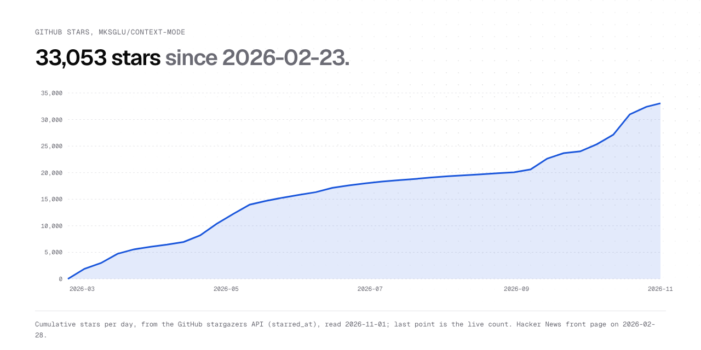</picture></a></td>
<td width="50%"><a href="https://contextmode.ai/open-source/stats?utm_source=github&utm_medium=readme&utm_content=adoption#daily"><picture><source media="(prefers-color-scheme: dark)" srcset="docs/assets/readme/npm-downloads-dark.png">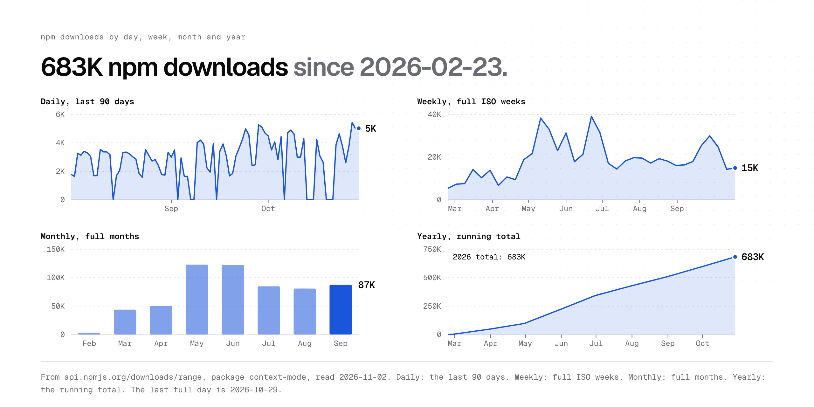</picture></a></td>
</tr></table>

Open the [interactive chart](https://contextmode.ai/open-source/stats?utm_source=github&utm_medium=readme&utm_content=adoption#daily) and point at a bar to read its value. Tabs there show days, weeks, months and years. Stars come from the GitHub GraphQL API (`starredAt`); npm downloads come from `api.npmjs.org/downloads/range`. The total up to 2026-10-29 is 683K npm downloads (`stats.json` keeps a daily copy). A daily job redraws both charts.

- **Hacker News.** "MCP server that reduces Claude Code context consumption by 98%" reached the front page with 570+ points and 107 comments on 2026-02-28 ([thread](https://news.ycombinator.com/item?id=47193064)).
- **GitHub Trending.** A bot that watches GitHub Trending logged the repo there on 14 days from 2026-04-24 to 2026-10-17 ([uibm/trending-watcher](https://github.com/uibm/trending-watcher/issues?q=%22mksglu%2Fcontext-mode%22)).

<picture>
  <source media="(prefers-color-scheme: dark)" srcset="docs/assets/readme/stargazers-dark.png">
  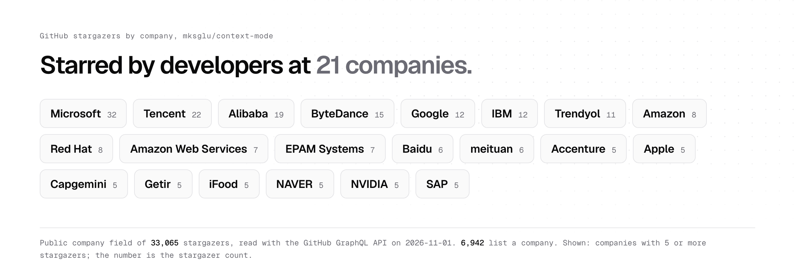
</picture>

Starred by engineers at these companies: each name is the company field of 2 or more stargazer profiles, read with the GitHub GraphQL API on 2026-11-01 ([data](docs/assets/readme/data/stargazer-companies.json)).

## Install

Pick your agent: [Claude Code](#install-claude-code) · [Codex](#install-codex) · [Gemini CLI](#install-gemini) · [Qwen Code](#install-qwen) · [Pi](#install-pi) · [OpenCode](#install-opencode) · [Copilot CLI](#install-copilot-cli) · [Kiro](#install-kiro) · [VS Code](#install-vscode) · [ZCode](#install-zcode)

Open its block and copy its own install command. Each block also holds the update, check and remove steps, and the [Install guide](https://contextmode.ai/docs/engine/install?utm_source=github&utm_medium=readme&utm_content=install) walks through them.

The plugin needs Node 24.15.0 or later, from the engines field in [package.json](package.json). On Windows, add Git for Windows: the shell tools run in Git Bash, and doctor checks for it.
contextmode installs as the npm package and command `context-mode`.
Claude Code, Codex, Gemini CLI and Qwen Code install from GitHub, and each of their commands names the release branch.

<details id="install-claude-code"><summary><b>Claude Code</b></summary>

```sh
claude plugin marketplace add mksglu/context-mode
claude plugin install context-mode@context-mode
```

```sh
# update
claude plugin update context-mode@context-mode
# check
claude plugin list
# remove
claude plugin marketplace remove context-mode
```

Hooks ✓ (package) · MCP ✓ · Skills ✓

</details>
<details id="install-codex"><summary><b>Codex</b></summary>

```sh
codex plugin marketplace add mksglu/context-mode
codex plugin add context-mode@context-mode
# one-time step: trust the plugin hooks
npm i -g context-mode
context-mode setup --agents codex
```

```sh
# update
codex plugin marketplace upgrade context-mode
# check
codex mcp list
# remove
codex plugin remove context-mode@context-mode
```

Hooks ✓ (hook file) · MCP ✓ · Skills ✓

</details>
<details id="install-gemini"><summary><b>Gemini CLI</b></summary>

```sh
gemini extensions install https://github.com/mksglu/context-mode
```

```sh
# update
gemini extensions update context-mode
# check
GEMINI_CLI_TRUST_WORKSPACE=true gemini mcp list
# remove
gemini extensions uninstall context-mode
```

Hooks ✓ (package) · MCP ✓ · Skills ✓

</details>
<details id="install-qwen"><summary><b>Qwen Code</b></summary>

```sh
qwen extensions install https://github.com/mksglu/context-mode:context-mode
```

```sh
# update
qwen extensions update context-mode
# check
qwen extensions list
# remove
qwen extensions uninstall context-mode
```

Hooks ✓ (package) · MCP ✓ · Skills ✓

</details>
<details id="install-pi"><summary><b>Pi</b></summary>

```sh
pi install npm:context-mode
```

```sh
# update
pi update --extensions
# check
pi list
# remove
pi remove npm:context-mode
```

Hooks ✓ (the plugin's own event handlers) · MCP ✓ (ctx tools built into the plugin) · Skills ✓

</details>
<details id="install-opencode"><summary><b>OpenCode</b></summary>

```sh
opencode plugin add context-mode
```

```sh
# update
opencode plugin update
# check
opencode mcp list --pure          # OpenCode 1.19
opencode mcp list --standalone    # OpenCode 2
# remove
opencode plugin remove context-mode
```

Hooks ✓ (the plugin's own event handlers) · MCP ✓ · Skills ✓

</details>
<details id="install-copilot-cli"><summary><b>Copilot CLI</b></summary>

```sh
npm i -g context-mode
context-mode setup --agents copilot-cli
```

```sh
# update
context-mode upgrade
# check
context-mode doctor --agents copilot-cli
copilot mcp list
# remove
context-mode setup --remove --agents copilot-cli
```

Hooks ✓ (hook file) · MCP ✓ · Skills ✓

</details>
<details id="install-kiro"><summary><b>Kiro</b></summary>

```sh
npm i -g context-mode
context-mode setup --agents kiro
```

```sh
# update
context-mode upgrade
# check
context-mode doctor --agents kiro
# remove
context-mode setup --remove --agents kiro
```

Hooks ✓ (hook file) · MCP ✓ · Skills ✓

</details>
<details id="install-vscode"><summary><b>VS Code (Copilot)</b></summary>

```sh
npm i -g context-mode
context-mode setup --agents vscode
```

```sh
# update
context-mode upgrade
# check
context-mode doctor --agents vscode
# remove
context-mode setup --remove --agents vscode
```

Hooks ✓ (hook file) · MCP ✓ · Skills ✓

</details>
<details id="install-zcode"><summary><b>ZCode</b></summary>

```sh
zcode plugins marketplace add mksglu/context-mode
zcode plugins install context-mode@context-mode
```

```sh
# update
zcode plugins update context-mode@context-mode
# check
zcode plugins list
# remove
zcode plugins uninstall context-mode@context-mode
```

Hooks ✓ (hook file) · MCP ✓ · Skills ✓

</details>

The npm route works for every agent:

```sh
npm i -g context-mode
context-mode setup
```

Setup is also the repair. It shows a plan, saves your earlier config, then applies the plan; when a step ends early, it restores the saved config. To uninstall:

```sh
context-mode setup --remove
npm rm -g context-mode
```

Restart the agent, then run `/ctx-doctor` in it. Each check prints PASS or a fix command, and the [Doctor guide](https://contextmode.ai/docs/engine/doctor?utm_source=github&utm_medium=readme&utm_content=install-doctor) explains each check.

<details><summary><b>How we tested the install</b></summary>

Every agent gets hooks, the MCP server and the plugin skills; the last line of each block above says how.
Hooks reach each agent in one of three ways: in the plugin package (Claude Code, Gemini CLI, Qwen Code), in a hook file (Codex, Copilot CLI, Kiro, VS Code, ZCode), or in a plugin inside the agent (OpenCode, Pi). The [Agents guide](https://contextmode.ai/docs/engine/agents?utm_source=github&utm_medium=readme&utm_content=install-agents) shows what each agent runs.
We ran the real binary of each agent with the plugin hook: Claude Code, Codex, Gemini CLI, Qwen Code, Pi, OpenCode, Copilot CLI and ZCode. Each run used a clean temp home and a local test model, on 2.0.0-next.15.
For VS Code and Kiro, the check covers the hook setup: VS Code runs the hook command with the documented payload, and kiro-cli 2.35.2 loads all 6 hook entries.
CI runs setup, doctor, a hook and an MCP handshake for all 10 agents from the packed package on Linux, macOS and Windows. Record: [HOOKS-FIRE.md](docs/architecture/release/HOOKS-FIRE.md).
Each agent uses its own install command, and [ADR-0023](docs/architecture/adr/ADR-0023-native-install.md) says why.

</details>

Your first task with the plugin, step by step: [First session](https://contextmode.ai/docs/engine/first-session?utm_source=github&utm_medium=readme&utm_content=install-next). Or paste a prompt from [Try it](#try-it) right now.

## Try it

Paste one of these prompts into your agent after the install. Each one ran once, live, in Claude Code 2.1.312, and its answer matched the source data ([evidence and rerun steps](bench/evidence/try-it-2026-11-02/README.md)). The headline numbers in [Benchmarks](#benchmarks) use the median of 5 runs. Other agents do the same job with the same tools: `ctx_execute`, `ctx_index` and `ctx_search`.
After a prompt, run the stats skill and read the report yourself ([See the saving](#see-the-saving)).
```text
On https://react.dev/reference/react/useEffect, show me the example that connects to a chat server and cleans up, and list the rules for the dependency array.
```
The hook sends WebFetch to the sandbox, and the agent searches the page for the example and the rules. 601,984 B raw, 20,860 B reached the context, 96.5% saved (2026-11-02, 2.0.0-next.26, claude-haiku-5-5).
```text
Fetch https://jsonplaceholder.typicode.com/photos. Which photo has the longest title (give its id and title), and how many photos have a title that contains the word "est"?
```
The agent runs code over 5,000 JSON records in the sandbox and gets back two answers. 1,039,898 B raw, 393 B reached the context, 99.96% saved (2026-11-02, 2.0.0-next.26, claude-haiku-5-5). The answer is two short facts, so this is the best case of the four.
```text
Here is a Linux syslog sample: https://raw.githubusercontent.com/logpai/loghub/master/Linux/Linux_2k.log. How many authentication failures does it contain, and which 3 remote hosts caused the most?
```
The agent counts failures in a 1,999-line syslog in the sandbox. 216,485 B raw, 566 B reached the context, 99.7% saved (2026-11-02, 2.0.0-next.26, claude-haiku-5-5).
```text
What are the top 10 stories on the Hacker News front page right now? Give title, points and domain for each.
```
The hook sends WebFetch to the sandbox, and the agent reads ten stories from the page. 35,087 B raw, 1,501 B reached the context, 95.7% saved (2026-11-02, 2.0.0-next.26, claude-haiku-5-5). The front page changes, so the raw size changes with each run.

### See the saving

Run the stats skill right after a prompt. Each agent uses its own command; the skill calls `ctx_stats` and shows its report unchanged.

| Agent | Command |
|---|---|
| Claude Code | `/ctx-stats` |
| Codex | `$ctx-stats` |
| Copilot CLI | `/ctx-stats` |
| Gemini CLI | `Call ctx_stats and show me the report.` |
| Kiro | `Call ctx_stats and show me the report.` |
| OpenCode | `Call ctx_stats and show me the report.` |
| Pi | `/skill:ctx-stats` |
| Qwen Code | `Call ctx_stats and show me the report.` |
| VS Code (Copilot) | `/ctx-stats` |
| ZCode | `Call ctx_stats and show me the report.` |

The first lines of a real report, after the JSON prompt above ran as one `ctx_execute` call:

```text
context-mode stats
────────────────────────────────────────────────────────────────────────────────

This session · 1 call · <1m active
  1015.5 KB became 3.7 KB: 1011.8 KB kept out (99.6%)
  Without context-mode |████████████████████████████████████████|  1015.5 KB
  With context-mode    |█░░░░░░░░░░░░░░░░░░░░░░░░░░░░░░░░░░░░░░░|     3.7 KB
  about 259K tokens kept out, 1.3 times a 200K window
```
Captured 2026-11-03 with 2.0.0-next.35: `release-out/server.mjs` over MCP in a temp HOME.

Next, the same numbers for 20 real tools, in [Use cases](#use-cases).

## Use cases

Real tool output from public projects, run through Context Mode. Bench of 2026-11-01 on 2.0.0-next.23 (commit 16a4bcc5), median of 5 runs.

| What you do | Tool | Raw | Reaches the context | Saved |
|---|---|---:|---:|---:|
| [Read a browser page](bench/a-sandbox/README.md#a-devtools-mcp-snapshot) | Chrome DevTools MCP `take_snapshot`, [Thinking in Code](#thinking-in-code) | 136,514 B | 463 B | 99.7% |
| [List 40 issues](bench/a-sandbox/README.md#a-gh-issue-list-vite) | GitHub CLI `gh issue list --json`, [Thinking in Code](#thinking-in-code) | 182,943 B | 850 B | 99.5% |
| [List 25 pull requests with checks](bench/a-sandbox/README.md#a-gh-pr-list-vite) | GitHub CLI `gh pr list --json`, [Thinking in Code](#thinking-in-code) | 195,471 B | 776 B | 99.6% |
| [Look up library docs](bench/a-sandbox/README.md#a-context7-query-docs-vite) | Context7 `query-docs`, [Thinking in Code](#thinking-in-code) | 6,917 B | 473 B | 93.2% |
| [Run 1,106 tests](bench/a-sandbox/README.md#a-vitest-run-vite) | Vitest `vitest run --reporter=verbose`, [Thinking in Code](#thinking-in-code) | 62,909 B | 429 B | 99.3% |
| [Lint a source folder](bench/a-sandbox/README.md#a-biome-lint-vite) | Biome `biome lint --reporter=json`, [Thinking in Code](#thinking-in-code) | 288,523 B | 577 B | 99.8% |
| [Install a workspace](bench/a-sandbox/README.md#a-pnpm-install-vite) | pnpm `pnpm install --frozen-lockfile`, [Thinking in Code](#thinking-in-code) | 14,988 B | 199 B | 98.7% |
| [Install packages](bench/a-sandbox/README.md#a-npm-install-log) | npm `npm install --loglevel http`, [Thinking in Code](#thinking-in-code) | 37,761 B | 435 B | 98.8% |
| [Read container logs](bench/a-sandbox/README.md#a-docker-logs-mongo) | Docker `docker logs`, [Thinking in Code](#thinking-in-code) | 60,374 B | 587 B | 99.0% |
| [Plan 72 resources](bench/a-sandbox/README.md#a-terraform-plan) | Terraform `terraform plan`, [Thinking in Code](#thinking-in-code) | 34,081 B | 166 B | 99.5% |
| [Read 300 commits with file stats](bench/a-sandbox/README.md#a-git-log-stat-vite) | git `git log --stat`, [Thinking in Code](#thinking-in-code) | 164,385 B | 268 B | 99.8% |
| [Read an 89 KB source file](bench/f-hook-redirect/README.md#f-read-vite-config) | Read, sent to `ctx_execute` by the hook | 91,362 B | 375 B | 99.6% |
| [Fetch a 265 KB docs page](bench/f-hook-redirect/README.md#f-webfetch-vite-docs) | WebFetch, sent to `ctx_index` and `ctx_search` | 271,731 B | 439 B | 99.8% |
| [Fetch a 214 KB API reply](bench/f-hook-redirect/README.md#f-bash-curl-post) | curl in Bash, replaced after it runs | 219,175 B | 291 B | 99.9% |
| [Print a 187 KB git log in Bash](bench/f-hook-redirect/README.md#f-bash-dump-post) | Bash, output replaced after it runs | 191,120 B | 204 B | 99.9% |
| [Print the same git log through a host tool](bench/d-externalize/README.md#d-real-git-log) | Host tool output over the cap, indexed whole | 191,120 B | 2,842 B | 98.5% |
| [Print a 214 KB GitHub API reply through a host tool](bench/d-externalize/README.md#d-real-github-json) | Host tool output over the cap, indexed whole | 219,175 B | 4,060 B | 98.1% |
| [Read a 45 KB log file](bench/f-hook-redirect/README.md#f-read-large-file) | Read, sent to `ctx_execute` by the hook | 46,216 B | 371 B | 99.2% |
| [Read a 60 KB source file](bench/f-hook-redirect/README.md#f-read-big-source) | Read, sent to `ctx_execute` by the hook | 61,576 B | 374 B | 99.4% |
| [Debug for a full session: 8 outputs, 3 searches](bench/g-overhead/README.md#g-session-total) | All hooks and tools | 281,261 B | 3,266 B | 98.8% |

Source: [bench/results/2026-11-01-darwin-arm64.json](bench/results/2026-11-01-darwin-arm64.json), one row per line; [SOURCE.md](bench/fixtures/data/SOURCE.md) names where each input comes from.
Click a task to open its case: the command, the input file with its sha256, and the run command, so you can run the same row on your machine.

The agent gets the part it asks for. The full output stays in the local index, and `ctx_search` reads it back.
Rows with a command run in the [sandbox](https://contextmode.ai/docs/engine/sandbox?utm_source=github&utm_medium=readme&utm_content=usecases); the agent then finds the rest with [search](https://contextmode.ai/docs/engine/search?utm_source=github&utm_medium=readme&utm_content=usecases).
The Context7 row has 6,917 B of raw output, under the 10 KB line of the headline rule, so the headline leaves it out.

Next, how the bench counts these bytes, in [Benchmarks](#benchmarks).

## Benchmarks

<picture>
  <source media="(prefers-color-scheme: dark)" srcset="docs/assets/readme/fig-saving-dark.png">
  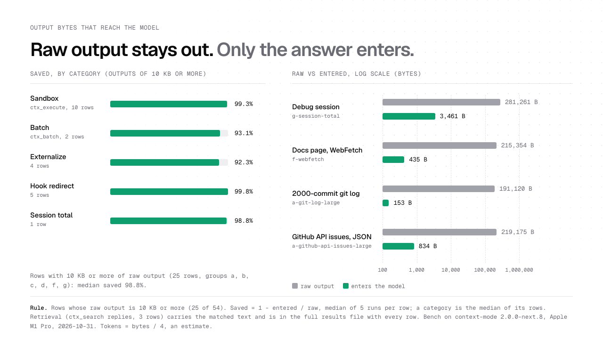
</picture>

Rule for every headline number in this README: rows with 10 KB or more of raw output, median of 5 runs per row, measured with `ctx_bytes` against `raw_bytes`; a category is the median of its rows; 1 KB = 1,024 B.
All 36 such rows, the six categories below: the plugin keeps a median of 99.4% of output bytes out of the context. Bench on 2.0.0-next.23 (commit 16a4bcc5 and the local edits that the file records), macOS arm64, 2026-11-01.

| Category | What runs | Rows | Median saved |
|---|---|---:|---:|
| a. Sandbox | `ctx_execute` on a file or command | 19 | 99.5% |
| b. Retrieval | `ctx_search` over the local index | 3 | 77.2% |
| c. Batch | `ctx_batch`: many commands, then search | 2 | 93.1% |
| d. Externalize | Host tool output over the cap, indexed whole | 4 | 98.3% |
| f. Hook redirect | A big Read, curl or WebFetch sent to the sandbox | 7 | 99.8% |
| g. Session total | One full scripted session | 1 | 98.8% |

Search replies (category b) carry the matching text, so they save 77.2%. Category e (long sessions) is in [Longer sessions](#longer-sessions). The full file lists every row, small ones too: [2026-11-01-darwin-arm64.md](bench/results/2026-11-01-darwin-arm64.md).
Reproduce with `cd bench && node run.mjs`. It needs plain Node and runs offline; [bench/README.md](bench/README.md) lists each scenario and its options.
Method, data files and rerun steps: [Benchmarks guide](https://contextmode.ai/docs/engine/benchmarks?utm_source=github&utm_medium=readme&utm_content=benchmarks).

### Longer sessions

<picture>
  <source media="(prefers-color-scheme: dark)" srcset="docs/assets/readme/fig-oss-dark.png">
  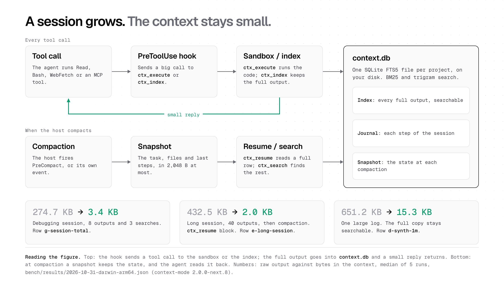
</picture>

Say you debug a slow test all afternoon. The agent reads files, runs the suite and fetches docs, and each result goes into the context window. When the window is full, the host compacts it, and from then on the agent sees a short summary plus your next message.

Context Mode keeps the full output of each large tool call in `context.db` on your machine and gives the agent a small reply. At compaction, a snapshot of at most 2,048 B keeps the session state. After the compaction, the agent calls `ctx_resume` to read that snapshot back and `ctx_search` to find any earlier output by keyword.

In the bench, a scripted session of 40 tool outputs and one compaction made a 442,893 B transcript, and the `ctx_resume` block that brought the agent back was 2,019 B (row `e-long-session` in the bench file; [open the case](bench/e-continuity/README.md#e-long-session)).
In the same bench, one large log of 666,796 B put 3,380 B into the context, and the full log stayed in the index for `ctx_search` (row `d-synth-1m`; [open the case](bench/d-externalize/README.md#d-synth-1m)).
How the snapshot picks what to keep: the [Long sessions guide](https://contextmode.ai/docs/engine/long-sessions?utm_source=github&utm_medium=readme&utm_content=longer-sessions) and [ADR-0009](docs/architecture/adr/0009-compaction-and-memory.md).

### Speed

Median of 5 runs, bench of 2026-11-01.

| Measure | Result |
|---|---|
| Hook time over a bare `node` start, per agent | 7.5 ms to 12.3 ms |
| `ctx_search`, 20 queries over 8 indexed files | 1.62 ms median, 6.70 ms max |
| `ctx_index`, 3 real files, 625,649 B | 150 ms per MB |

Source: rows `g-hook-kiro` to `g-hook-claude-code`, `g-search-latency` and `g-index-per-mb` of [the bench file](bench/results/2026-11-01-darwin-arm64.md), with every agent and query. The [overhead cases](bench/g-overhead/README.md) show how each one runs.

Next, what happens inside one tool call, in [How it works](#how-it-works).

## How it works

<picture>
  <source media="(prefers-color-scheme: dark)" srcset="docs/assets/readme/fig-flow-dark.png">
  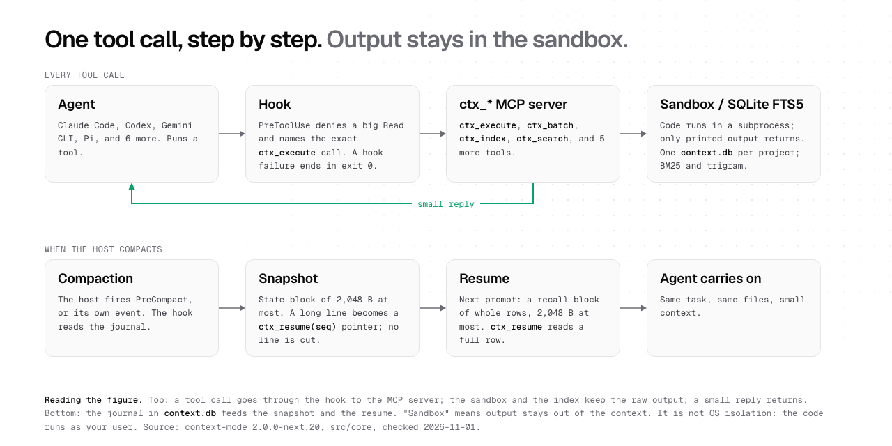
</picture>

One tool call, in time order, from the install to a hook error.

1. **Install.** Each agent's own install command adds the MCP server, the hooks and the skills `ctx-doctor`, `ctx-stats` and `ctx-upgrade` to that agent's config folder, for example `~/.codex/skills/<name>/SKILL.md`. `context-mode setup` writes or repairs any part the native command leaves out ([ADR-0023](docs/architecture/adr/ADR-0023-native-install.md)).
2. **Session start.** The `SessionStart` hook opens the project database. When the session ran before, the agent gets one line that tells it to call `ctx_resume` ([dispatch.ts](src/core/hooks/dispatch.ts)).
3. **PreToolUse checks.** Before a tool runs, the `PreToolUse` hook checks the call in a fixed order: the user's deny list, WebFetch, curl and wget, inline HTTP and build commands, then a full-file Read over `OUTPUT_CAP` (16,384 B) and one-file shell dumps such as `cat` or `tail`. A Read with a line range runs as usual ([decide.ts](src/core/policy/decide.ts)).
4. **The exact call.** When a check matches, the hook stops the call and its reply names the exact `ctx_*` call to use, for example `ctx_execute` with `{"language":"shell","code":"<the command>","intent":"<what you need>"}`. For WebFetch the reply names `ctx_index`, then `ctx_search` ([read-deny.ts](src/core/policy/read-deny.ts)).
5. **The sandbox.** This is the Thinking in Code step: the agent's script runs here, and only what it prints comes back. `ctx_execute` writes the script to a temp folder and spawns the runtime from an argument list in the project folder. The timeout is `EXEC_TIMEOUT_MS` (600,000 ms, default and maximum); on timeout it stops the whole process group (`taskkill /F /T` on Windows). The child gets your environment minus preload variables such as `NODE_OPTIONS`, and the agent gets what the script prints, at most `OUTPUT_CAP` ([execute.ts](src/core/tools/execute.ts)).
   <a id="thinking-in-code"></a>**Thinking in Code.** The agent sends a short script as a tool parameter, the script reads the data in the sandbox, and only what it prints goes into the context. Two real calls, in the form the Claude Code terminal shows them:

   `ctx_execute` on 5,000 JSON records, from the Claude Code 2.1.312 stream of the Try-it run with Context Mode 2.0.0-next.26 ([04-api-json.json](bench/evidence/try-it-2026-11-02/04-api-json.json)). The data is 1,039,898 B; the agent gets 254 B.

   ```text
   ⏺ context-mode - ctx_execute (MCP)(language: "javascript", c…jsonplaceholder.typicode.com/photos\");
     if (!res.ok) throw new Error(\"HTTP \" + res.status);
     const photos = await res.json();
     let longest = null;
     for (const p of photos) {
       if (!longest || p.title.length > longest.title.length) longest = p;
     }
     const withEst = photos.filter(p => p.title.includes(\"est\")).length;
     const ties = photos.filter(p => p.title.length === longest.title.length).map(p => p.id);
     console.log(JSON.stringify({ total: photos.length, longest…nd count of titles containing \"est\"")
     ⎿  exit 0 · 239 B
        {
          "total": 5000,
          "longest": {
            "id": 653,
            "title": "temporibus commodi et fugit doloremque re…rit exercitationem necessitatibus aut",
            "length": 86
          },
          "longestTieIds": [
            653
          ],
          "titlesContainingEst": 892
        }
   ```

   `ctx_batch` on an install log and a long git log, one live MCP call to `release-out/server.mjs` of Context Mode 2.0.0-next.36 on 2026-11-03 ([2026-11-03-ctx-batch.json](bench/evidence/thinking-in-code/2026-11-03-ctx-batch.json)). The commands print 228,881 B; the agent gets 8,667 B, the parts that match its two queries, and the full output stays in the index.

   ```text
   ⏺ context-mode - ctx_batch (MCP)(commands: ["cat npm-install… queries: ["cache miss","feat commit"])
     ⎿  ## cache miss
        js.org/@esbuild%2fwin32-x64 282ms (cache miss)
        npm http fetch GET 200 https://registry.npmjs.org/@esbuild%2flinux-s390x 79ms (cache miss)
        npm http fetch GET 200 https://registry.npmjs.org/@esbuild%2fopenbsd-x64 101ms (cache miss)
        npm http fetch GET 200 https://registry.npmjs.org/@esbuild%2fwin32-arm64 99ms (cache miss)
        npm http fetch GET 200 https://registry.npmjs.org/@esbuild%2fdarwin-arm64 99ms (cache miss)
        … +95 lines (ctrl+o to expand)
   ```
6. **Indexing.** The full output goes into the index in chunks of at most `MAX_CHUNK_BYTES` (4,096 B). A Markdown chunk stays inside one heading section, and a code block that fits stays whole. Each chunk goes into two SQLite FTS5 tables: a Porter-stemmed table for words and a trigram table for paths, names and parts of words ([fts.ts](src/core/store/fts.ts)).

   `ctx_index` on a copy of this repo's `docs/how-it-works.md`, one live MCP call to `release-out/server.mjs` of Context Mode 2.0.0-next.36 on 2026-11-03 ([calls.json](bench/evidence/terminal-calls-2026-11-03/calls.json)). The file is 11,577 B; the agent gets 64 B.

   ```text
   ⏺ context-mode - ctx_index (MCP)(path: "how-it-works.md")
     ⎿  Indexed 1 source(s), 17 chunk(s) from s1. Label: how-it-works.md
   ```
7. **Search.** `ctx_search` ranks each table with BM25 and joins the two lists with Reciprocal Rank Fusion: a hit scores 1/(`RRF_K` + rank), with `RRF_K` = 60. Before it returns an empty list, it tries a spelling fix from the indexed words. Search covers this session, this worktree (the default) or the whole project, and each snippet is at most `SNIPPET_MAX_BYTES` (800 B) ([search.ts](src/core/tools/search.ts)).

   `ctx_search` on that index, in the same run, in a project that also holds an `AGENTS.md`. One search reads the index and every agent's memory files. The agent gets 1,268 B: one content hit and one memory hit, each with its source and heading. For memory shared across machines, agents and sessions, see [Context Mode Gateway Memory](https://contextmode.ai/docs/memory?utm_source=github&utm_medium=readme&utm_content=search-memory).

   ```text
   ⏺ context-mode - ctx_search (MCP)(queries: ["compaction state block"])
     ⎿  Query "compaction state block":
        how-it-works.md #14: ### Session continuity
        
        The hooks log each prompt, edit, command, tool error, i…e same rows always give the same bytes.
        memory AGENTS.md #0: # Agent rules
        … +10 lines (ctrl+o to expand)
   ```
8. **Run, then replace.** On hosts that run the tool first, the `PostToolUse` hook checks the result. Output over `REPLACE_TRIGGER_BYTES` (4,096 B) goes into the index whole, and the agent gets the best-matching chunks and one `ctx_search` line for the rest ([dispatch.ts](src/core/hooks/dispatch.ts)).
9. **Journal and compaction.** The hooks log each prompt, edit, command, tool error and decision in a journal. After a compaction the agent gets a state block of at most `STATE_BUDGET` (2,048 B), and each long line becomes a `ctx_resume(seq)` pointer to the full row; one `ctx_resume` reply is at most `RESUME_CAP` (2,048 B). On the next prompt, a prompt-match block brings back the journal rows that match it by BM25 ([ADR-0009](docs/architecture/adr/0009-compaction-and-memory.md)).

   `ctx_resume` with empty parameters returns the state block, in the same run: 209 B.

   ```text
   ⏺ context-mode - ctx_resume (MCP)()
     ⎿  <context_mode_state session="mcp:85e67fa2-28ef-45eb-9d5b-a967129b74c0" upto="2">
        indexed how-it-works.md
        source s1: how-it-works.md (11536 B)
        more: ctx_search(queries:[], scope:"session")
        </context_mode_state>
   ```
10. **The database.** Each project has one `context.db` under `~/.context-mode`, in Node's built-in `node:sqlite`. The database runs in WAL mode and runs a PASSIVE checkpoint on close. A new database gets built under a temp name and moves into place in one atomic step, and the busy timeout is `DB_TIMEOUT_MS` (5,000 ms) ([db.ts](src/core/store/db.ts)).
11. **A hook error.** A hook always ends with exit 0. On any error it gives the host's allow reply and writes one log line to `~/.context-mode/hook-errors.log`, so your agent keeps working. A spawned hook has `HOOK_TIMEOUT_MS` (5,000 ms) ([fallback.ts](src/core/hooks/fallback.ts)).

Every number with its reason: [How it works](docs/how-it-works.md). The rules the hook follows: [ADR-0008](docs/architecture/adr/0008-enforcement-rewrite-and-cap.md). Next, the [Tools](#tools) the agent calls.

## Tools

| Tool | What it does |
|---|---|
| `ctx_execute` | Runs code or a shell command in a sandbox; returns what it prints |
| `ctx_batch` | Runs many commands, indexes the output, and searches it in one call |
| `ctx_index` | Indexes a file, a text or a URL into the project database |
| `ctx_search` | Searches the local index; returns the matching parts |
| `ctx_resume` | Returns the plugin's local state block (at most 2,048 B), or one full row by `seq` |
| `ctx_stats` | Shows how much output stayed out of context |
| `ctx_doctor` | Checks the install; each check prints PASS or a fix command |
| `ctx_upgrade` | Installs, upgrades or uninstalls; replaces old contextmode entries |
| `ctx_purge` | Deletes indexed data by session, source or project |

Three more real calls, from the same live run of Context Mode 2.0.0-next.36 on 2026-11-03 ([calls.json](bench/evidence/terminal-calls-2026-11-03/calls.json)).

`ctx_stats`: the agent gets 3,097 B, the first line is the summary.

```text
⏺ context-mode - ctx_stats (MCP)()
  ⎿  ctx_stats: 82.5% kept out all-time, 82.5% this session.
     … +59 lines (ctrl+o to expand)
```

`ctx_doctor` after `context-mode setup --agents claude-code`: 862 B, one row per check.

```text
⏺ context-mode - ctx_doctor (MCP)()
  ⎿  Environment: context-mode 2.0.0-next.36 (8facf27), agent claude-code 0 (client r20-live)
     Environment: darwin-arm64, Node v26.8.1, shell /bin/zsh
     | Check | Status | Detail | Fix |
     |---|---|---|---|
     | D1 version | PASS | 2.0.0-next.36 (8facf27): ahead of next on npm (2.0.0-next.34) |  |
     | D2 node | PASS | ok |  |
     … +11 lines (ctrl+o to expand)
```

`ctx_purge` deletes one source: 66 B.

```text
⏺ context-mode - ctx_purge (MCP)(source: "how-it-works.md")
  ⎿  ctx_purge: deleted 18 rows (scope: source). This cannot be undone.
```

Full reference: [Tools](https://contextmode.ai/docs/engine/tools?utm_source=github&utm_medium=readme&utm_content=tools).

Commands in the agent: `/ctx-stats` shows the `ctx_stats` result, `/ctx-doctor` runs `ctx_doctor` (send its report with a defect report), and `/ctx-upgrade` runs `ctx_upgrade`, then `ctx_doctor`.

## Security and privacy

- The plugin keeps all its data on your machine, one database per project in `~/.context-mode`, and `ctx_purge` deletes it by session, source or project. Read the [Security guide](https://contextmode.ai/docs/engine/security?utm_source=github&utm_medium=readme&utm_content=security).
- The plugin has zero telemetry: usage data, events and crash reports stay on your machine. It uses the network for four calls, each one started by you or your agent:

| Call | When | File |
|---|---|---|
| Fetch of a URL, for `ctx_index` | Your agent asks for a page. The fetch blocks private and link-local addresses, checks each address the host name points to, connects to the address it checked, and checks again at each redirect. | [fetch.ts](src/core/sandbox/fetch.ts) |
| One read of the npm dist-tags, with `git ls-remote` of the release tags as the fallback | You run `context-mode doctor`, to check for a new version | [doctor-env.ts](src/core/ops/doctor-env.ts) |
| `npm i -g context-mode`, or `gh issue create` | You run `context-mode upgrade`, or you press a key to send the debug report | [commands.ts](src/cli/commands.ts) |
| Your agent's own install command, npm or git | You install or update | Your agent |

- The guard test D-PRIVACY-NET-1 in [tests/0008-enforcement.test.mjs](tests/0008-enforcement.test.mjs) scans the source for HTTP clients, sockets, DNS lookups, git network calls and gh or npm spawns. It flags each new call site, so this table stays true.
- Doctor and the debug report remove secrets by their structure before they print.

Code from `ctx_execute` runs on your host as your user, with your files, your network and your environment except the preload variables, so keep your agent's own permission prompts on. Here "sandbox" means the output stays in the sandbox and out of the context.
What the plugin stores, where, and how to delete it: [Privacy](https://contextmode.ai/docs/engine/privacy?utm_source=github&utm_medium=readme&utm_content=privacy).

## Context Mode Gateway

The plugin works on tool output, on your machine, and it is complete on its own. Context Mode Gateway is a separate hosted service with its own account and subscription. It works on every request, across all your agents. Its 11 features, the full list: Context Saving, Recall, Memory, Skills, Search, Session resume, Active Context, Instructions, Protect, Prompt caching, Live and Analytics.
Add the Gateway when you want savings on every request, memory across sessions and agents, or cost reports for a team. For one project on one machine, the plugin covers the job. The two work together: [Gateway guide](https://contextmode.ai/docs/engine/gateway?utm_source=github&utm_medium=readme&utm_content=gateway).
Gateway Recall, Search and Session resume run on the Gateway server, across sessions and agents. The plugin's `ctx_search` and `ctx_resume` read the local `context.db` of one project.
With the Gateway on, your requests pass through its server; the plugin keeps its own data on your machine.

| Product | Runs | Scope | Billing |
|---|---|---|---|
| Context Mode plugin | On your machine | One project, local `context.db` | Free |
| Context Mode Gateway | Hosted service | All sessions and agents | Subscription, separate from the plugin |

Set up the Gateway with one command:

```sh
npx @context-mode/cli
```

`npx @context-mode/cli` signs you in to your Gateway account, which has its own subscription, and writes one config change per agent.
Apps: Claude Code, Claude Desktop, Codex, Codex Desktop, T3 Code, OpenCode and Pi. The Gateway CLI needs Node 20.12 or later, from its npm engines field.

<a href="docs/assets/readme/gateway/live.mp4">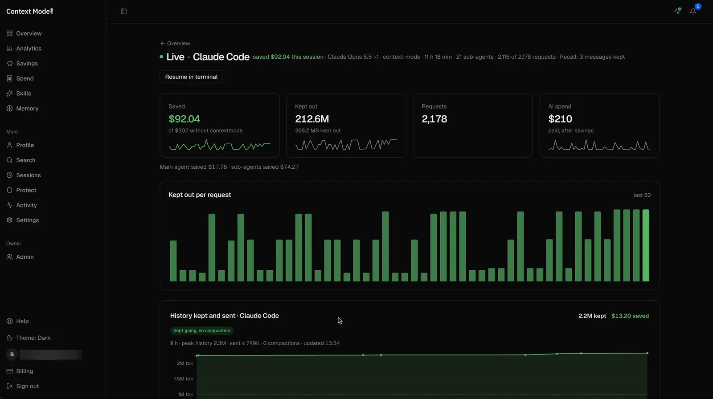</a>

**Live.** One session as it runs: money saved this session, bytes kept out per request, history kept and sent, and a feed of each request with its cost and saving. Click the image for the full video.

Docs: [How saving works](https://contextmode.ai/docs/how-saving-works?utm_source=github&utm_medium=readme&utm_content=live)

<table>
<tr><td width="50%"><a href="docs/assets/readme/gateway/overview.webp">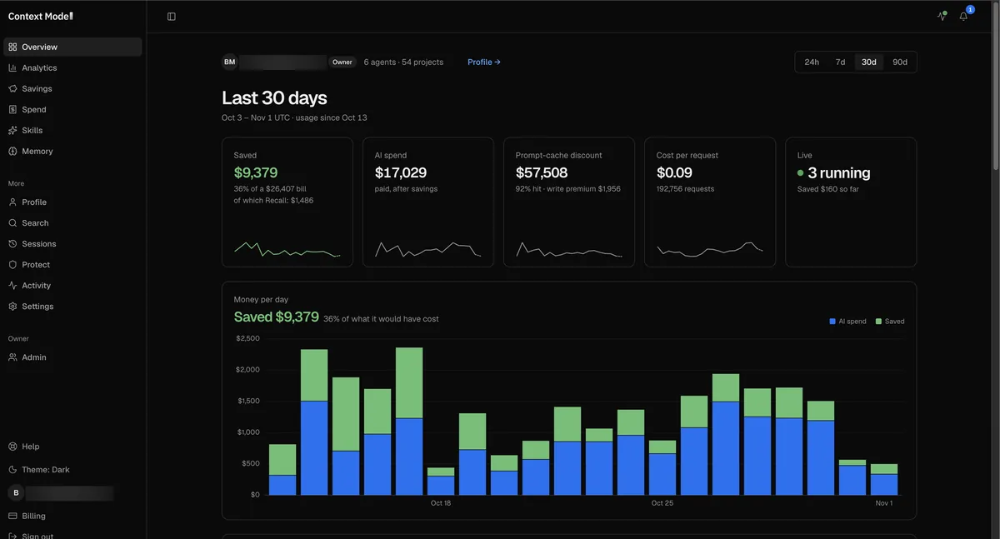</a><br><b>Overview.</b> Your spend and what the Gateway saved, per day, in one view.<br>Docs: <a href="https://contextmode.ai/docs/how-saving-works?utm_source=github&utm_medium=readme&utm_content=overview">How saving works</a></td><td width="50%"><a href="docs/assets/readme/gateway/analytics.webp">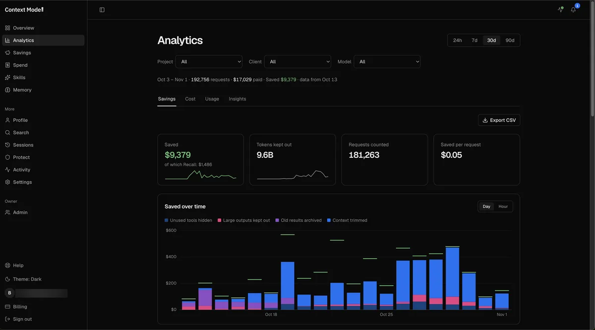</a><br><b>Analytics.</b> Where each saving comes from: hidden tools, archived old results, large outputs kept in the archive and trimmed context.<br>Docs: <a href="https://contextmode.ai/docs/how-saving-works?utm_source=github&utm_medium=readme&utm_content=analytics">How saving works</a></td></tr>
<tr><td width="50%"><a href="docs/assets/readme/gateway/spend.webp">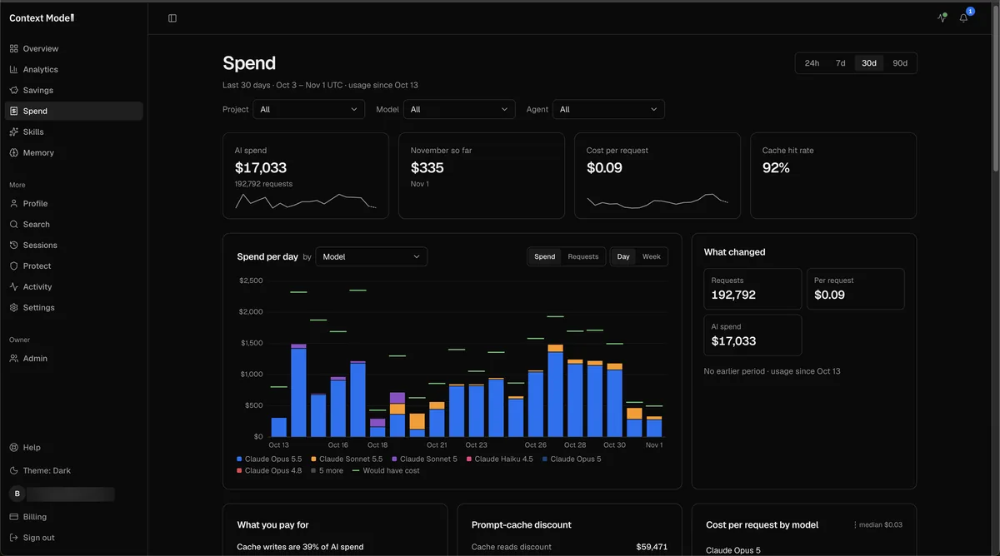</a><br><b>Spend.</b> Spend per day and per model, cost per request and the cache hit rate, to help you plan a budget.<br>Docs: <a href="https://contextmode.ai/docs/prompt-caching?utm_source=github&utm_medium=readme&utm_content=spend">Prompt caching</a></td><td width="50%"><a href="docs/assets/readme/gateway/memory.webp">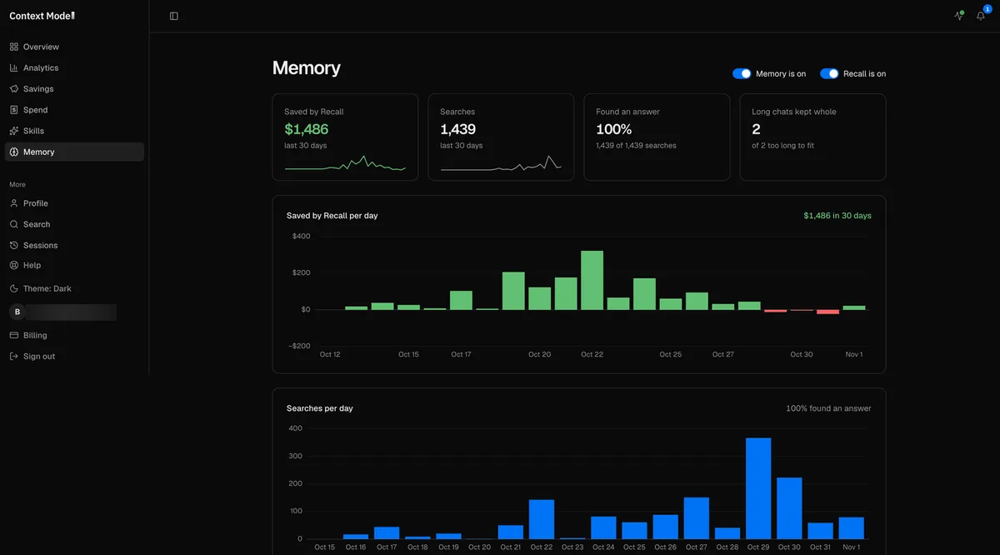</a><br><b>Memory.</b> Facts and decisions carry across sessions and agents. The screen shows what Recall saved and how many searches found an answer.<br>Docs: <a href="https://contextmode.ai/docs/memory?utm_source=github&utm_medium=readme&utm_content=memory">Memory</a></td></tr>
<tr><td width="50%"><a href="docs/assets/readme/gateway/skills.webp">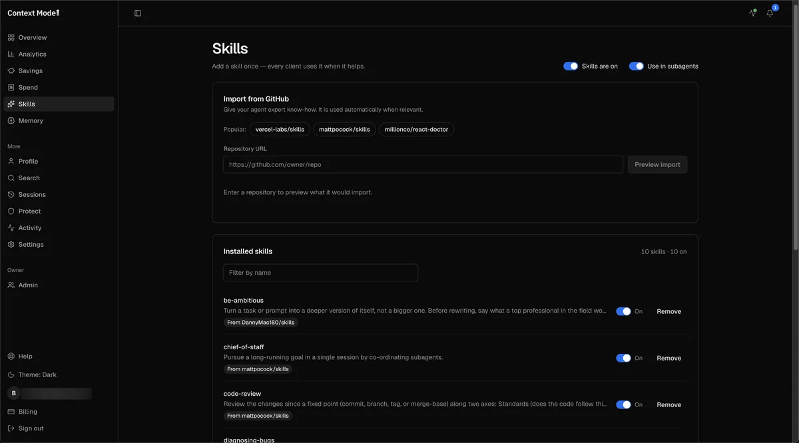</a><br><b>Skills.</b> Add a skill once and all your clients use it when it helps. Import skills from GitHub and see the installed ones.<br>Docs: <a href="https://contextmode.ai/docs/skills?utm_source=github&utm_medium=readme&utm_content=skills">Skills</a></td><td width="50%"><a href="docs/assets/readme/gateway/protect.webp">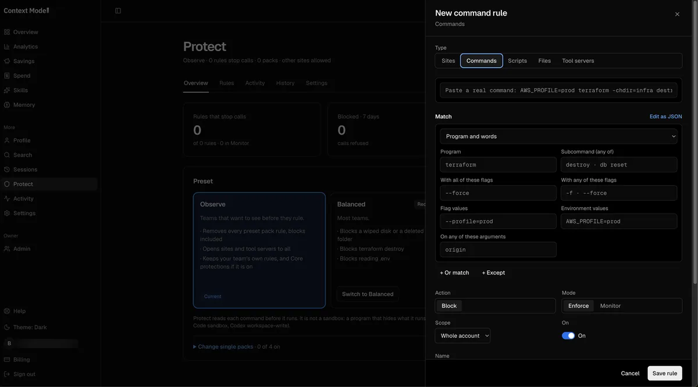</a><br><b>Protect.</b> Rules that check each shell command before it runs. Here, a rule that stops <code>terraform destroy</code>.<br>Docs: <a href="https://contextmode.ai/docs/protect?utm_source=github&utm_medium=readme&utm_content=protect">Protect</a></td></tr>
</table>

Numbers in these screens come from the author's own account over 30 days (Oct 3 - Nov 1, 2026), so read them as one account's usage. Click an image for the full size.

Three prompts to try with the Gateway on. The line under each one names the feature it shows.
```text
Move this project from Jest to Vitest. Convert every test file, fix the config, run the suite after each batch, and tell me what is left.
```
Memory keeps the plan and the file list across a long job.
```text
Pick up where we stopped yesterday on the Jest to Vitest move. What is done, what is left, and which test was failing?
```
Recall brings back yesterday's work in a fresh session.
```text
Which date library did we choose on Tuesday, and why did we reject the other two?
```
Search finds the answer in past sessions.

<details>
<summary>Gateway features, from contextmode.ai/docs</summary>

Source: [contextmode.ai/docs](https://contextmode.ai/docs/how-saving-works?utm_source=github&utm_medium=readme&utm_content=features):

| Feature | What it does | What you get | Details |
|---|---|---|---|
| Context Saving | Folds old tool output, runs data work as code (Thinking in Code), trims tool schemas, places cache marks | A tool output over 2,048 B becomes a short pointer, with the full copy archived | Saves the most on sessions with many tool calls |
| Recall | The model sees recent work and an index of older work; the agent searches the archive for the rest | Gateway, Claude Code, Opus 5.5, 200K window, 2026-10-04: mean cost per session $4.8627 to $3.0353 (-37.6% in dollars, `ab.json` below) | Cost measured in Claude Code on Claude Opus 5.5 |
| Memory | Each fact keeps two times: when it was true and when the Gateway learned it | Claude Code and Codex on one account share one store, tested end to end | The memory block goes into the first request of a new session |
| Skills | A skill catalog on the Gateway for your account; it loads the skill that matches your message | The matching skill loads on the message that needs it | Import skills from GitHub; a loaded skill joins the prompt in full |
| Search | Searches the prompts, commands and tool output that passed through, in the console and as an agent tool | Find any past prompt, command or tool output, from the console or your agent | The console searches the first 4,000 characters of each tool result |
| Session resume | One command rebuilds a conversation as a native Claude Code or Codex session | Continue a conversation in Claude Code or Codex | Restores the text, tool names and a summary; the command is valid for 15 minutes |
| Active Context | Sets how much a thread carries before its oldest parts move to the archive: 200K, 500K or 1M tokens | Pick the window size per thread | An image older than the kept part becomes a short text note |
| Instructions | One text of at most 4,096 characters that tells every agent how to answer you | Read from the provider cache after the first request | Sets how the agent writes to you |
| Protect | A tool-call firewall: checks shell commands, file reads and writes, web fetches and tool-server calls by what they do | Each call checked before it runs | Reads the call itself, so keep your agent's sandbox on for script files and paths built at run time; opt-in |
| Prompt caching | Keeps requests cache-friendly: cache marks on the fixed part of the prompt and a cache for fetched pages | Inside the measured costs above | Uses up to 4 cache marks, the provider's maximum |
| Live and Analytics | Shows each request and what the Gateway saved, as it happens and over time | See each request and its saving, live and over time | Covers every request that passes through the Gateway |

</details>

Gateway only: its cost against Claude Code alone, Claude Opus 5.5, mean dollars per session at list price. The plugin numbers are in [Benchmarks](#benchmarks).

- Six short tasks (2026-09-29): 24.5% fewer dollars pooled over 176 sessions (21% to 29% per task). [v3-opus55-short.json](https://contextmode.ai/benchmarks/data/v3-opus55-short.json?utm_source=github&utm_medium=readme&utm_content=bench)
- Long Claude Code session, 200K window (2026-10-03/04): mean cost per session $4.8627 to $3.0353 (-37.6% in dollars, mean of 3 pairs). [ab.json](https://contextmode.ai/benchmarks/recall/200k-r2/ab.json?utm_source=github&utm_medium=readme&utm_content=bench)
- We fixed the rules before each run: [contextmode.ai/docs/benchmarks](https://contextmode.ai/docs/benchmarks?utm_source=github&utm_medium=readme&utm_content=bench).

The Gateway routes to Anthropic and OpenAI. The Gateway sends your requests to its server on the way to the model. It keeps a searchable record of your sessions for Recall and Search, and masks secrets and e-mail addresses when it reads archived output back. Its privacy page is at [contextmode.ai/privacy](https://contextmode.ai/privacy?utm_source=github&utm_medium=readme&utm_content=privacy).
Keep your agent's own sandbox on next to Protect.

## License

Elastic License 2.0 (ELv2, the `LICENSE` file), a source-available license. You may use, copy, change and share the code, and use it at work, free of charge.
The license keeps three uses for the licensor:

1. Offering the software to others as a hosted or managed service that gives them a large part of its features.
2. Moving, changing, turning off or getting around the license key functions, or removing or hiding what the license key protects.
3. Changing, removing or hiding the licensor's license, copyright or other notices.

We chose ELv2 so the source stays open to all and the hosted service stays with the project.

## Community

Report a defect on [Discord](https://discord.gg/DCN9jUgN5v) with the full `/ctx-doctor` report, and send ideas there too. The maintainer writes every change; [CONTRIBUTING.md](CONTRIBUTING.md) shows how an agent files an issue.

**Videos.** [Better Stack on Context Mode](https://www.youtube.com/watch?v=QUHrntlfPo4). Make your own video and share it on [Discord](https://discord.gg/DCN9jUgN5v); we add videos over 10K views here.
