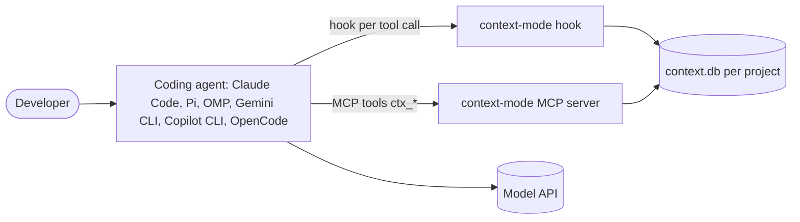
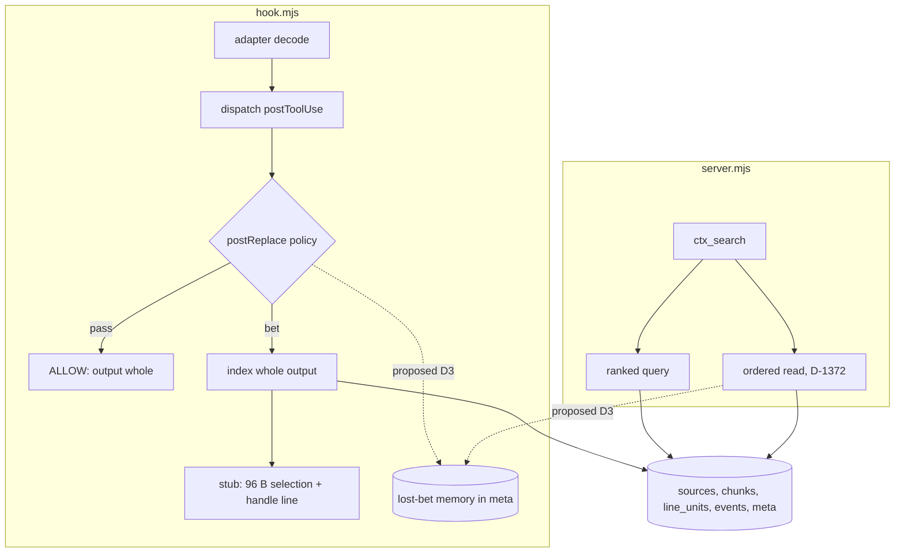
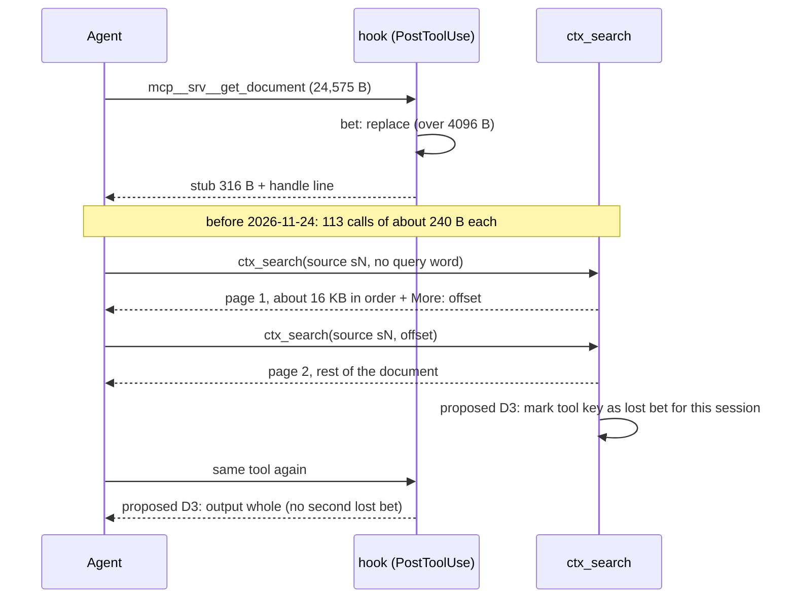
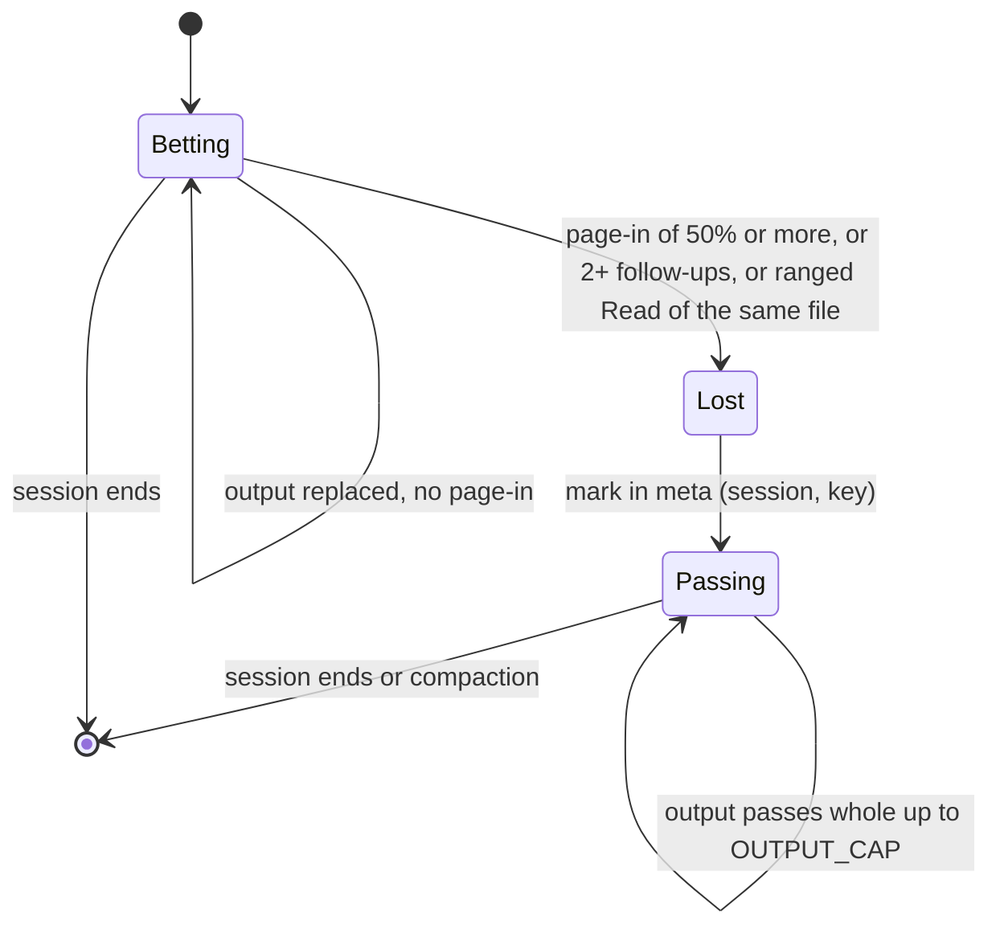
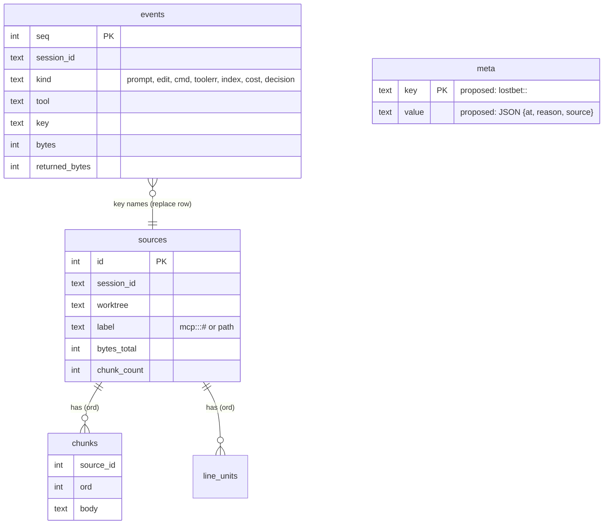

# ADR-0027: Replace policy. The cost of a lost bet, exact page-in, and no trigger setting

- Status: Proposed (2026-11-24).
- Scope: one file for the whole decision (ADR, product decision, PRD, RFC and the rest), as the owner asks ("tek bir md").
- Issues: [#1372](https://github.com/mksglu/context-mode/issues/1372) (limekiln, samelie), [#1379](https://github.com/mksglu/context-mode/issues/1379) (Ticki84), [#1381](https://github.com/mksglu/context-mode/issues/1381) (chchaffin), [#1326](https://github.com/mksglu/context-mode/issues/1326) (suntimental, coreycoburn), [#1325](https://github.com/mksglu/context-mode/issues/1325) (mkaring), and the owner's own report (2026-11-24: "surekli kesiliyor bir is yaparken", "cok kotu bir deneyim").
- Keeps: ADR-0008 (one OUTPUT_CAP), ADR-0009 section 8 (search), ADR-0016 (large output stays out of the context), ADR-0021 (prompt cache safety), ADR-0024 (tests by ADR area), ADR-0025 decision 1 (stored source in the sandbox), NO-LOSSY-CUT.md, the owner rules: no env and no flag ("ana kural hicbir zaman flag env kullanmiyoruz"), the saving must not drop, perf must not drop, no new tool, no regex, zero telemetry, no TRUNCATE.
- Labels: [measured] = a run we did, with its source. [reported] = a number from an issue. [modeled] = arithmetic on stated inputs, not a run. [proposed] = not built.

## 0. Summary

1. A replace is a bet: "the agent does not need the whole output". The bet wins for most outputs and loses for one class. In 5,101 local replaces [measured], 0.03% of Bash replaces are followed by a whole read, and 44.02% of full Read replaces are.
2. A lost bet cost up to 113 calls or lost data, because the way back was a ranked search used as a reader. That part is fixed on main (D-1372-ORDERED-READ-1: 113 calls to 2 for a 24.5 KB document).
3. `CTX_REPLACE_TRIGGER_BYTES` exists because one fixed number is wrong for some classes. It moves the number for every class at once, so a user who raises it to fix Read pays with the Bash saving, where the bet almost never loses. It also breaks the no-env rule. It goes.
4. In its place: (a) every replaced output has an exact way back in one or two calls, (b) the system remembers a lost bet and stops making that bet for the rest of the session, (c) the gate for replace changes measures the cost of a task, not only bytes per output.
5. One decision needs the owner: the meaning of "saving" in the gate (section 9, D4).

## 1. Glossary

| Term | Meaning |
|---|---|
| Replace | PostToolUse returns a short stub instead of the tool output. The whole output is stored and indexed first (NO-LOSSY-CUT.md). |
| Stub | What the model gets: a 96 B selection (REPLACE_RETURN_BYTES) of 48 B chunks (REPLACE_CHUNK_BYTES) plus the handle line. |
| Handle line | `ctx_search({queries:[...], source:"sN"}) searches the whole output (N B).` (REPLACE_HANDLE_LINE). |
| Trigger | The output size over which a replace happens: 4096 B (REPLACE_TRIGGER_BYTES_DEFAULT). Today the env var `CTX_REPLACE_TRIGGER_BYTES` can move it. |
| Bet | The replace decision. It wins when the agent finishes without the hidden bytes. |
| Lost bet | The agent needs the hidden bytes and calls again to get them. |
| Whole-seeker | A replace whose follow-ups return at least 50% of the hidden bytes, or that gets 3 or more follow-up calls on the same source (r89 corpus rule). |
| Page-in | Getting hidden bytes back. Exact page-in: in order, byte for byte, in ceil(size / page) calls. |
| Class | A group of tool outputs: Bash, full Read, ranged Read, MCP JSON, MCP text, WebFetch, other. |
| Tool key | The tool name plus its main input (Bash command, Read path, MCP server and tool). |
| Net saving (bytes) | (hidden bytes - stub bytes - follow-up reply bytes) / output bytes. The gate used by #1379 and #1372. |
| Task cost | What the user pays for one task: input tokens (cache read, cache write, uncached), output tokens, calls and wall time. |
| Thrash | Fetch, lose, fetch again. The same bytes are paged in more than once in one task. |
| Lost-bet memory | [proposed] Per session state: a tool key or a file whose bet was lost once is not replaced again in that session. |

## 2. Root cause analysis (RCA)

### 2.1 Timeline

| Date | Event | Source |
|---|---|---|
| v1.0.169 | PostToolUse records events only and never replaces. Outputs reach the model whole. Protection is PreToolUse routing and prompt rules. | r68-1379 notes, v1 `hooks/posttooluse.mjs:224` |
| 2026-10-20 | v2 replace path. Trigger 4096, return 1024, then 512, then 96; chunk 256, then 48. The bench showed `big-json` at -67.94 with a 1 KB return and WebFetch at -3.17. | D-M7-SV-1, -2, -3 |
| 2026-10-27 | A source with no matching query word lists its chunks by position (H9). Built as a fallback, not as a reader. | D-HL-H9-1 |
| 2026-10-30 | Ranked replies hold 5 hits (SEARCH_REPLY_HITS) for recall quality. | D-SEARCH-REPLY-1 |
| 2026-11-06 | #1326: skill reference files cut; coreycoburn asks an env knob for 2-6 KB Bash outputs and sends a fork commit. | #1326 |
| 2026-11-08 | Own instruction files pass whole (D-R48-OWN-FILE-1). `CTX_REPLACE_TRIGGER_BYTES` added as a documented setting. Bench: 4096 saves 41.99%, 6144 30.89%, 8192 23.34%. | D-R48-TRIGGER-1 |
| 2026-11-12 | #1372: an MCP JSON document read whole by the agent. Replaced arm 6 and 29 calls, 450k and 975k tokens; whole arm 1-2 calls, 134k-198k tokens [reported]. Asks an env exclude list. | #1372 |
| 2026-11-14 | #1379: 4 KB cutoff friction. A richer stub cuts calls 15% but lowers net bytes 1 point; no-go, by design. #1381: asks a per-model trigger; models break-even per model price [modeled]. | #1379, #1381 |
| 2026-11-24 | Owner hits the same friction ("cok kotu bir deneyim"). Corpus of 5,101 replaces measured. Ordered read ships: 113 calls to 2. | r89 notes, D-1372-ORDERED-READ-1 |

### 2.2 Five whys (the friction)

1. Why does the agent stop and fetch again? Its bet was lost: the stub did not hold what it needed.
2. Why was the fetch so costly? The way back was a ranked search with 5 hits of 48 B per page, or an 800 B snippet of a 3.5 KB chunk. It took 113 calls, or it lost 77% of a one-line JSON [measured].
3. Why was a ranked search the way back? The read by position (H9) reused the constants of three other goals: the ranked page size, the snippet cap and the stub chunk size. Each was tuned alone.
4. Why did the gates not see it? Every gate measured bytes per output. The cost of a lost bet is mostly calls: each call re-reads the whole cached context, writes output tokens and takes seconds. Bytes do not show that.
5. Why do users reach for an env var? The only lever they have is the trigger, and it moves every class at once.

### 2.3 Root causes

| ID | Root cause | Status |
|---|---|---|
| RC1 | The gate measures net bytes per output, not the cost of a task. A lost bet's real cost (an extra turn over a large cached context, output tokens, wall time) is not in the number. | Open (D4) |
| RC2 | No exact page-in. The way back was a ranked search, not a reader. | Fixed for ctx_search (D-1372-ORDERED-READ-1). Read uses the host's ranged Read. |
| RC3 | One trigger for every class. Bash bets win (0.03% whole-seekers); full Read bets lose 44% of the time [measured]. | Open (D3) |
| RC4 | No memory of a lost bet. After the agent pages in a file once, the next full Read of the same file is replaced again. | Open (D3) |
| RC5 | The escape hatch is a global env var. It is invisible to doctor and stats and trades the Bash saving for the Read fix. | Open (D1, lane r90) |

### 2.4 Contributing factors

- 4,784 of 5,101 replaces (94%) happen in subagents [measured]. A subagent context is short: a hidden byte saves fewer later cache reads there, and a lost bet costs the same extra turn. The bench that tuned the trigger ran main sessions. [modeled, see section 15]
- The model cannot see the stub's cost. On Fable the output price is 200 times a cache read, on Opus 5.5 and Sonnet 5.5 100 times [reported, #1381], so the same lost bet costs more on some models.
- The owner's report also covers a second product. The Gateway withholds tool descriptions (a fetched schema lasts one turn) and cuts large tool inputs in history. That is the same pattern in another bounded context (section 10.4). It is out of scope for this ADR and has its own note.

## 3. Jobs to be done (JTBD)

| When | I want to | So that |
|---|---|---|
| my agent runs a command with large output | the output stays out of the context | my session lasts longer and costs less |
| my agent needs every line of a file, a document or a JSON result | it gets all of it at once, in order | it does not loop, guess or miss records |
| my agent needed the whole thing once | it is not cut again in this task | I do not watch it fetch the same file 3 times |
| something is cut | I can see why, and the agent knows how to get the rest | I trust the tool and do not turn it off |
| I install context-mode | I set nothing | it works well for every tool and every model with no tuning |

## 4. Ideal customer profile (ICP)

| Segment | Profile | What hurts today |
|---|---|---|
| Primary | A developer on Claude Code (also Pi, OMP, Gemini CLI, Copilot CLI, OpenCode) with long sessions, many subagents and MCP servers. | Full Read and MCP documents cut, extra calls, lost records. |
| Secondary | A team on a paid model plan who counts tokens (the #1381 profile). | The cost of a lost bet differs by model; the default is tuned on one. |
| Tertiary | A maintainer who must explain behavior in issues. | An env var changes behavior and is not in the bug report. |

## 5. Non-goals

- No env var, flag, setting, config list or per-model value (#1372 and #1381 asks). Every user gets the same default.
- No change to the trigger number in this ADR. The bench numbers stand (D-R48-TRIGGER-1).
- No new MCP tool.
- No model price table in the OSS. Prices change, and a stale table gives wrong answers silently (the Gateway had this exact bug on 2026-11-24 with two missing models).
- No telemetry. All learning uses the local journal on the user's machine.
- No Gateway change here (section 10.4).
- No change for Codex: it has no replace row.

## 6. Positioning and UVP

- Positioning: context-mode keeps tool output out of the context without making the agent blind.
- UVP: large output stays out by default, every hidden byte comes back exactly in one or two calls, and the tool learns in each session which outputs your agent reads whole. You set nothing.
- What changes for the message: from "we save 95% of bytes" to "we save cost per task, and your agent never loses data". The headline numbers keep the bench rule (90%+ only, rule-bench-headline-90s).

## 7. Product decision record (PDR)

| Question | Decision | Why |
|---|---|---|
| Keep `CTX_REPLACE_TRIGGER_BYTES`? | No. Remove it; doctor shows one INFO line when it is still set. | Main rule. It moves all classes at once and hides from bug reports. |
| Add an exclude list (#1372)? | No list. The system learns the same thing from lost bets (D3). | Main rule; a list is a guess that goes stale; learning uses evidence. |
| Add a per-model trigger (#1381)? | No. Revisit when the host puts the model on PostToolUse. | Main rule; no model field on Claude Code PostToolUse (#1381 probe); no price table in OSS. |
| Pass full Read whole? | No, not as a rule. Lost-bet memory makes it pass whole after the first lost bet per file. | #1379: whole Read drops net bytes from 52.9% to 0%. |
| Change the gate? | Owner decision (D4). Recommended: task cost first, bytes as a guard. | RC1. |

## 8. PRD

### 8.1 Goal

A lost bet costs at most one extra call per tool key per session, and no data is lost, while the default saving holds.

### 8.2 Functional requirements

| ID | Requirement | Status |
|---|---|---|
| FR1 | Every replaced output can be read back in order, byte for byte, in ceil(size / page) calls, page about OUTPUT_CAP. | Done for ctx_search (D-1372-ORDERED-READ-1). |
| FR2 | The stub names the exact way back that the caller can call: `ctx_search` with the source for the main session; the file path for a full Read (`Read` with offset and limit); the persisted file for a large Bash (D-CC-POINTER-6). | Partly done. Full Read: [proposed]. |
| FR3 | `CTX_REPLACE_TRIGGER_BYTES` is not read. The trigger is the constant 4096. | Lane r90 (on its branch). |
| FR4 | Doctor shows one INFO line when `CTX_REPLACE_TRIGGER_BYTES` is set in the process env or in a Claude Code settings `env` block: it is no longer read; large outputs are stored and come back with ctx_search; the line can go. | Lane r90. |
| FR5 | Lost-bet memory: when a replaced source is paged in (ordered read reaches 50% or more of it, or 2 or more follow-ups on it), or when the same file gets a ranged Read after its full Read was replaced, the tool key or file is marked for the session. Later outputs with that key pass whole up to OUTPUT_CAP. | [proposed] |
| FR6 | `ctx_stats` shows replaces, lost bets and page-in calls per class for the session. | [proposed] |
| FR7 | The docs say what is replaced, why, and how the agent gets it back. No doc names an env var as a fix. | Lane r90 removes the doc line. |

### 8.3 Acceptance criteria (AC)

- AC1: a 24,575 B MCP JSON document comes back whole in at most 2 calls, and a 17,279 B one-line JSON in at most 2 calls [measured on main: 2 and 2].
- AC2: with `CTX_REPLACE_TRIGGER_BYTES=8192` in the env, a 5,000 B Bash output is replaced (the env has no effect).
- AC3: doctor prints the INFO line when the env var is set, and nothing about it when it is not.
- AC4: after one lost bet on file F in session S, the next full Read of F in S passes whole; a full Read of another file G is still replaced; in a new session F is replaced again.
- AC5: on the replay corpus, net saving (bytes) on Bash does not drop, and calls per replace on full Read drop.
- AC6: the PostToolUse hook p50 does not rise beyond noise (median of 50, interleaved).
- AC7: no file in the repo tells users to set `CTX_REPLACE_TRIGGER_BYTES`.

## 9. RFC: options, trade-off matrix and the ADR decision

### 9.1 Options

| ID | Option | Source |
|---|---|---|
| O1 | Keep the env var as is | status quo, D-R48-TRIGGER-1 |
| O2 | Env exclude list of tools | #1372 ask |
| O3 | Per-model trigger env | #1381 ask |
| O4 | Raise the default trigger (8192 or 16384) | #1326 fork commit |
| O5 | Pass every full Read whole | #1379 option |
| O6 | Richer stub on every replace (line count, matching range, ready call) | #1379 A/B |
| O7 | Exact page-in, lost-bet memory, remove the env var, task-cost gate | this ADR |
| O8 | Per-call cost model from the transcript (context size, model, price) | idea |

### 9.2 Trade-off matrix

Score: + good, 0 neutral, - bad. Evidence column says where the score comes from.

| Option | Bytes saved | Task cost | Calls on a lost bet | Rule fit | Upkeep | Risk | Evidence |
|---|---|---|---|---|---|---|---|
| O1 | + | - for full Read users | - | - env | 0 | users trade Bash saving away | D-R48 bench, r89 corpus |
| O2 | 0 | + for listed tools | + | - env | - list goes stale | silent saving loss | #1372 |
| O3 | 0 | + per model | 0 | - env | - price table rots | wrong break-even | #1381 modeled |
| O4 | - (41.99% to 23.34% at 8192) | + for 4-8 KB reads | + | + | + | large saving loss | D-R48 bench |
| O5 | - (Read 52.9% to 0%) | + | + | + | + | large saving loss | #1379 corpus |
| O6 | - (88.00% to 86.98%) | 0 | + (calls -15%) | + | 0 | bytes on every replace | #1379 A/B |
| O7 | + (0 B on winning bets) | + | + (one per key per session) | + | 0 | needs the memory to be right | r89 corpus, this ADR |
| O8 | + | + | + | 0 (no env, but reads host transcript format) | - transcript format and prices change | fragile | #1381 probe |

### 9.3 Decision (ADR)

- D1: Remove `CTX_REPLACE_TRIGGER_BYTES`. REPLACE_TRIGGER_BYTES is the constant 4096. Doctor shows the INFO line (FR3, FR4). Amends D-R48-TRIGGER-1.
- D2: Exact page-in for every replaced output (FR1, FR2). Kept: D-1372-ORDERED-READ-1, D-CC-POINTER-6. New: a full Read stub names the file and its line count so the agent reads the rest with offset and limit in one call [proposed; must pass the gate in D4 because it adds bytes to Read stubs].
- D3: Lost-bet memory per session (FR5), in the meta table, keyed by session and tool key or file. No setting, no telemetry, nothing leaves the machine.
- D4 (owner): the gate for replace policy changes is task cost on the replay corpus and on the live saving-score runs: cache-weighted input tokens, output tokens, calls and wall time per task. Net bytes stay a guard: they must not drop on any class with fewer than 5% whole-seekers (Bash today). Until the owner confirms D4, the gate stays net bytes, and D2 for full Read waits.
- D5: Model-aware triggers (#1381) wait for a model field on PostToolUse. No transcript parsing, no price table.
- D6: Measure main and subagent separately in every gate (94% of replaces are in subagents).

### 9.4 Release order

D1 removes the user's workaround. It ships together with the first change that lowers the cost of a lost bet on full Read (D3), not alone. D-1372-ORDERED-READ-1 already covers MCP and Bash outputs.

## 10. Architecture

### 10.1 C4 level 1: context



### 10.2 C4 level 2 and 3: containers and the replace components



The policy order today (src/core/hooks/dispatch.ts postReplace): size under the trigger, bounded Read, OMP ranged path, own instruction file, Skill load, non-text MCP result, host has no replace row, subagent with no route, plugin MCP call. Each of these is a pass that was added after an issue. D3 adds one evidence-based pass in place of new per-issue rules.

### 10.3 Domain model (DDD) and bounded contexts

| Bounded context | Owns | Language | Lives in |
|---|---|---|---|
| Capture | decode host events, canonical tool call | event, tool, canonical name | src/adapters, src/core/hooks |
| Replace policy | the bet: pass or replace | bet, trigger, class, pass rule, lost-bet memory | src/core/hooks/dispatch.ts postReplace |
| Store | sources, chunks, journal rows | source, handle, chunk, event row | src/core/store |
| Retrieval | getting hidden bytes back | ranked query, ordered read, page, offset | src/core/tools/search.ts |
| Measure | saving, calls, lost bets | net saving, task cost, whole-seeker | src/core/tools/stats.ts, bench/ |
| Diagnose | telling the truth about setup | check, INFO line | src/core/tools/doctor.ts |
| Gateway (other product) | hosted proxy, schema and input handling | withheld schema, de-inlined input | separate repo, not this ADR |

Aggregates: a Source (label, handle, chunks, bytes_total) is created once per replaced output and never edited. A Session holds its journal rows and, with D3, its lost-bet marks. Invariant: every hidden byte of a Source can be read back in order (NO-LOSSY-CUT.md).

### 10.4 The same pattern in the Gateway (out of scope)

The owner's pasted session shows the agent restate one root cause 11 times, load a skill twice without its text, and fetch the Workflow tool definition 4 times. The causes there are Gateway features: tool descriptions withheld (a fetched schema lasts one turn) and large tool inputs cut in history. The same guarantees apply (exact page-in, instructions are never cut while in use, the working set stays until the step ends, the agent's own actions stay readable). That work belongs to the Gateway repo and its own writer.

### 10.5 Sequence: lost bet, today and with this ADR



### 10.6 State machine: one tool key in one session



Over OUTPUT_CAP the output is replaced in every state, because OUTPUT_CAP is the one cap (ADR-0008).

### 10.7 Data model (ERD)



D3 needs no new table: the meta table already holds per-session keys (D-1396 compact-state keys, compacted:<sid>).

## 11. API contract

### 11.1 ctx_search ordered read (shipped, D-1372-ORDERED-READ-1)

- When: a `source` is given and no query word is in that source (blank query, or words absent from it, as the MCP pointer's tool name).
- Reply: one head line, then the next stored bytes in order, then `More: ctx_search({queries:[""], source:"sN", offset:<byte offset>})` while bytes are left.
- Size: each reply at most OUTPUT_CAP; every page but the last at least OUTPUT_CAP - 1024 text bytes.
- Law: pages joined = the stored text, byte for byte.
- A query with matching words: unchanged ranked reply.

### 11.2 PostToolUse replace (unchanged shape)

- Pass: no output change (the host shows its own output).
- Replace: Claude Code `updatedMCPToolOutput` for MCP, `updatedToolOutput` `{stdout, stderr, interrupted}` for Bash (D-M7-SV-1), a string for other tools. Body = selection + handle line (+ twin line, + persisted-file line D-CC-POINTER-6).

### 11.3 Doctor INFO line (lane r90)

- Check: planned in D4 old entries (the leftovers row); lane r90 picks the final check.
- Text (positive wording): the variable is set, context-mode does not read it, large outputs are stored and come back with ctx_search, the line can be removed from the settings file it names.

## 12. Error model and idempotency

| Case | Behavior | Rule |
|---|---|---|
| Another session holds the write lock | The write goes to the project spool and the next hook write applies it; the handle is the label until then. | D-1401-SPOOL-1 |
| The store cannot be opened (for example EACCES) | The hook logs to hook-errors.log and answers empty: the host keeps its whole output (fail open). | #1386 part A, D-1385-NOLINK-1 |
| Unknown source in ctx_search | isError true and the stored sources listed. | D-SEARCH-UNKNOWN-SOURCE-1 |
| Offset past the end | The paging line says no more bytes. | D-LABEL-HANDLE-2 |
| Memory mark write fails (D3) | The bet stays as today. The failure never blocks a tool. | proposed |

Idempotency: a stored source is never edited, so `ctx_search(source, offset)` returns the same bytes every time. A lost-bet mark is a set of keys: writing it twice has the same effect. The doctor INFO line reads only.

## 13. NFR, SLI and SLO

| NFR | SLI | SLO |
|---|---|---|
| The hook stays fast | PostToolUse p50 and p95, median of 50 | No rise beyond noise (today about 8.6 ms p50 on the MCP replace path [measured]) |
| A lost bet is cheap | page-in calls per lost bet | at most ceil(S / OUTPUT_CAP), and at most one lost bet per key per session with D3 |
| No data loss | bytes reachable / bytes stored per source | 100% |
| The saving holds | net bytes per class on the replay corpus | no drop on classes with under 5% whole-seekers |
| The task gets cheaper | cache-weighted tokens and calls per task (saving-score) | down or equal (D4) |
| Behavior is the same for every user | settings that change replace | 0 |

## 14. Gherkin

```gherkin
Feature: replace policy

  Scenario: the trigger env var has no effect
    Given CTX_REPLACE_TRIGGER_BYTES is 8192 in the hook env
    When Bash returns 5000 bytes
    Then the output is replaced
    And doctor shows one INFO line that the variable is not read

  Scenario: a replaced MCP document comes back whole
    Given an MCP tool returned a 24575 byte JSON document that was replaced
    When the agent calls the pointer and then its More: line
    Then the joined replies equal the document byte for byte
    And the agent made 2 calls

  Scenario: a lost bet is not made twice (proposed)
    Given a full Read of file F was replaced in session S
    And the agent read F again with offset and limit
    When the agent runs a full Read of F in session S
    Then the output passes whole
    And a full Read of file G in session S is still replaced
```

## 15. Unit economics [modeled]

Inputs: an output of T tokens; context C tokens; later requests in the same context N; cache read price r, uncached input price 10r (Anthropic list ratio), output price o (100r on Opus 5.5 and Sonnet 5.5, 200r on Fable [reported, #1381]); a lost bet costs k extra calls with about u output tokens each.

- A won bet saves about T x 10r on the next request plus T x r on each of the N later requests: T x r x (10 + N).
- A lost bet saves nothing (the bytes come back) and costs k x (C x r + u x o).
- Expected value per replace with lost-bet rate p: EV = (1 - p) x T x r x (10 + N) - p x k x (C x r + u x o).

Example: T = 2,000 (a 7 KB file), C = 60,000, k = 1, u = 150, o = 100r.
- Bash, p = 0.0003: EV is positive for any N.
- Full Read, p = 0.44: EV = 0.56 x 2,000 x (10 + N) r - 0.44 x (60,000 + 15,000) r = (11,200 + 1,120 N - 33,000) r. Positive only when N > 19.
- So a full Read replace pays in a long main session and loses in a short subagent, where most replaces happen. This is a model, not a measure. Action A3 measures it from transcript usage.

D3 lowers p for the rest of the session to near 0 for a key that lost once, so the loss is paid at most once per key.

## 16. Go-to-market and pricing

- Pricing: no change. The OSS stays free. The Gateway plans do not change.
- GTM: one release note line per change in plain words: "Large outputs come back in one or two calls; context-mode learns in each session which files your agent reads whole; the CTX_REPLACE_TRIGGER_BYTES setting is gone because the default now covers it." Issue comments on #1372, #1379, #1381, #1326 with the measured numbers.
- Proof for the README: the D-1372 numbers (113 calls to 2) and, after D3, calls per lost bet. Headline rule unchanged (90%+ only).

## 17. Edge cases

| Case | Handling |
|---|---|
| One-line JSON (no newline to cut at) | Ordered read pages by stored byte offset, not by chunk (D-1372). |
| Output over OUTPUT_CAP after a lost bet | Still replaced (ADR-0008 one cap); ordered read pages it. |
| Same file, other range | A ranged Read always passes (D-R41). |
| File changes between reads | The mark is per file path; a new full Read is a new output and passes whole while the mark holds. |
| Subagent with no route to the store | Passes whole already (D-1382). |
| Plugin MCP call | Passes whole already (D-1402). |
| Compaction | Marks end with the session step (state machine). |
| Env var set in settings but not in the process | Doctor reads the settings env block too (FR4). |
| Two sessions on one project | Marks are per session id. |
| A tool key that is a secret-bearing command | The key is stored in the local meta table only, like journal keys today. |

## 18. Rollout

| Step | What | Gate | Where |
|---|---|---|---|
| 1 | Ordered read (D-1372) | done: 113 to 2 calls, ranked replies byte-identical | main 541d7726 |
| 2 | Remove the env var, doctor INFO line, docs (D1) | AC2, AC3, AC7 | lane r90, not on main |
| 3 | Lost-bet memory (D3) | AC4, AC5, AC6 on the replay corpus (tickets r89 replay scripts) | lane r92-9002, done: D-0027-LOSTBET-1, red 4cefeec7, ships with step 2 |
| 4 | Steps 2 and 3 to main together, one release | full CI, release smoke | main |
| 5 | Gate change (D4) after the owner's yes; then the full Read stub (D2) | task-cost gate | new lane |
| 6 | Revisit per-model when the host adds a model field | host changelog | watch |

Rollback: each step is one commit range on main. Reverting step 3 restores today's bets; the env var stays removed.

## 19. Runbook

| Symptom | Check | Action |
|---|---|---|
| A user says "output is cut and my agent loops" | `ctx_stats` lost bets per class (after FR6); doctor INFO line for the env var | If one key loops after a lost bet, D3 did not mark it: collect the journal rows (kind, key, bytes) and open a bug. |
| A user still sets CTX_REPLACE_TRIGGER_BYTES | Doctor D4 INFO line | Remove the line from settings; nothing else is needed. |
| ctx_search reply is not in order | The query has words that match the source | Ranked by design; the pointer with no matching words reads in order. |
| Saving dropped in a release | Replay corpus per class | Find the class; revert the step that changed it. |

## 20. Action items

| ID | Action | Owner | Status |
|---|---|---|---|
| A1 | Ship lane r90 (D1) with step 3, not alone | Claude | lane r90 running |
| A2 | Build lost-bet memory (D3) with RGR, replay gate and profile | Claude | done on lane r92-9002 (D-0027-LOSTBET-1), ships with A1 |
| A3 | Add task cost to the replay: cache read, cache write, output tokens and calls per task from transcript usage; split main and subagent | Claude | next lane |
| A4 | Decide D4: does "saving must not drop" mean task cost (with bytes as a guard)? | Owner | open |
| A5 | Build ADR-0025 decision 1 (ctx_execute reads a stored source) for count and filter jobs (#1325) | Claude | after A2 |
| A6 | Comment on #1372, #1379, #1381, #1326 when steps 2 and 3 ship | Claude | after release |
| A7 | Gateway: apply the four guarantees to withheld schemas and cut inputs | Gateway writer | handoff note written |

## 21. Evidence

- r89 corpus [measured]: 16,978 local Claude Code transcripts, 5,101 replaces (317 main, 4,784 subagent). Net bytes: ALL 74.59%, Bash 94.94% (3,436, whole-seekers 0.03%), full Read 26.76% (1,640, whole-seekers 44.02%, 1,977 follow-up calls), MCP JSON n 2, MCP text n 6. Ordered read A/B: equal bytes on every class at every page size (the path was unused locally).
- r68 corpus [measured]: 3,744 replaces, net 88.00%, 888 follow-up calls; richer stub 86.98% with 754 calls (no-go). The two corpora differ in size and follow-up rule, so their net numbers differ.
- #1372 repro on 2.2.2 and main [measured]: pretty JSON 24,575 B: 113 calls, 63,429 B; one-line JSON 17,279 B: 15 of 80 records reachable. After D-1372: 2 calls each, whole.
- D-R48-TRIGGER-1 bench [measured]: 602 transcripts, 28,390 calls: trigger 4096 saves 41.99%, 6144 30.89%, 8192 23.34%.
- D-M7-SV-1 to -3 bench [measured]: big-json -67.94 at a 1 KB return, 89.67 at 96 B; WebFetch -3.17.
- #1372 A/B [reported]: replaced 6 and 29 calls, 450k and 975k tokens; whole 1-2 calls, 134k-198k tokens (2 runs per arm).
- #1381 [reported, modeled]: no model field on Claude Code PostToolUse; modeled net cost saving at 4096: Opus 12.3% to 22.3%, Sonnet 7.0% to 16.4%, Fable -7.4% to 6.5%.
